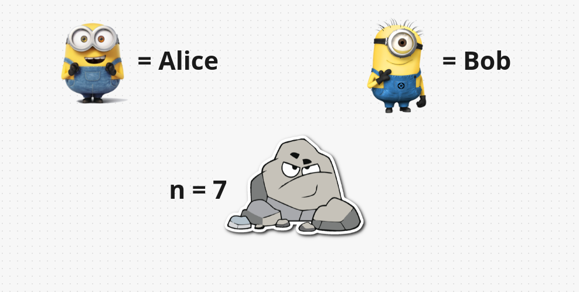
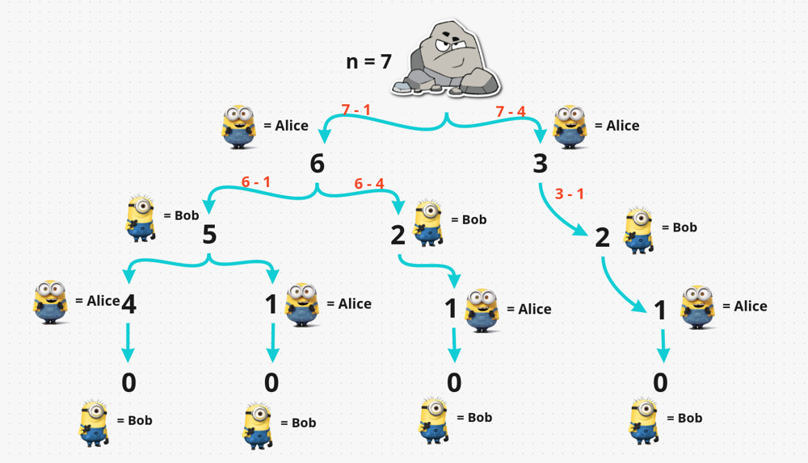
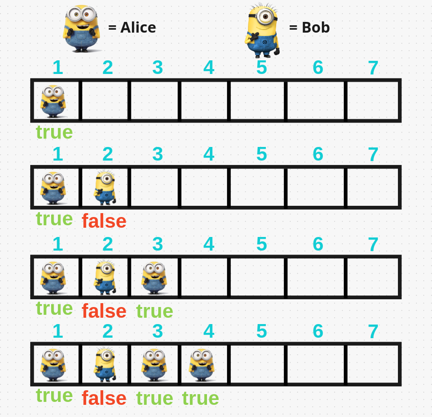
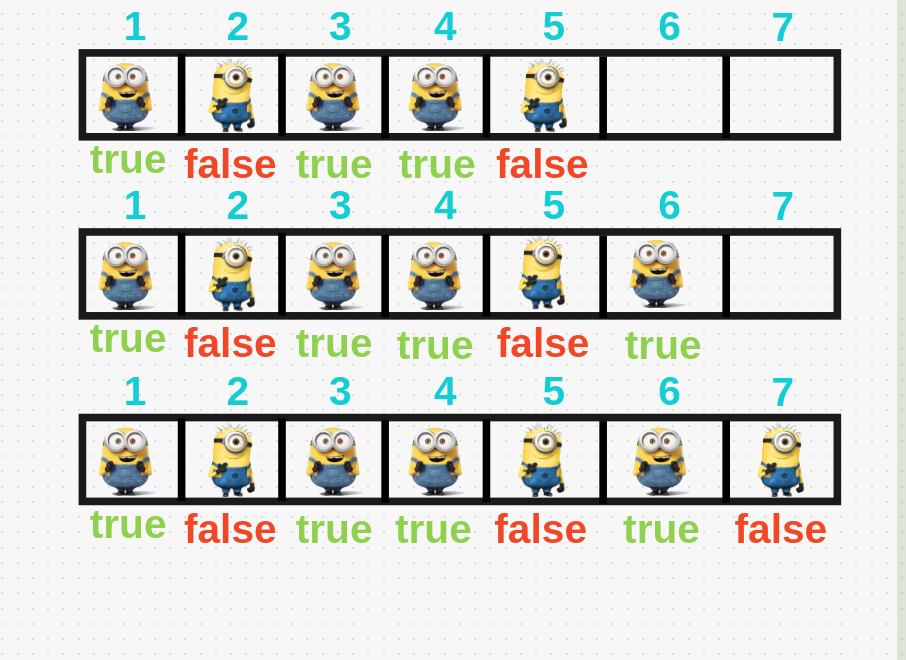

# Easy Explanation, you will definitely gonna understand

**Author:** hi-malik
**Votes:** 163
**Link:** [https://leetcode.com/problems/stone-game-iv/solutions/1708369/](https://leetcode.com/problems/stone-game-iv/solutions/1708369/)

---

<hr>
<hr>

```
Well to be honest this is really not a hard problem. But, anyways our JOB is to solve it. Let's do it
```

<hr>
<hr>

`First understand this problem with an example`. Take **n = 7** where n denotes no. of **stone**



As, **Alice always start game first** to remove stone. So, how many choices can he make to remove **7** stones is:
> **1 ^ 1 = 1**
> **2 ^ 2 = 4**

`So, he can only make 2 choices`



* `So, from 7 stones Alice 1st remove 1 stone & then Alice remove 4 stones` 
* * When **Alice remove 1 stone** the remaining stone **left is 6**. 
* * But If **Alice remove 4 stones** then remaining stones **left are 3.**
* `Now it's Bob turn. Bob as well can make only 2 moves i.e. 1 OR 4 which is less than 6`
* * When **Bob remove 1 stone** from branch **6** the remaining stone **left is 5**. But If **Bob remove 4 stones** from branch **6** then remaining stones **left are 2**.
* * But in **Branch 3 Bob can only remove 1 stone**, so remaining **left is 2.**
* `Now it's Alice turn.` 
*  * From **branch 5 if Alice decide to remove 1 stone** remaining stone **left is 4**. But, if **alice** decide to **remove 4 stone** remaining stone **left is 1.**
*  * From **branch 2 if Alice decide to remove 1 stone** remaining stone **left is 1.** 
*  * From **another branch 2 if Alice decide to remove 1 stone** remaining stone **left is 1**
*  `Now the Bob turn and every branch is ending with perfect square`. So, **Bob can remove from any branch because there is no branch from Alice can win.**

So, as you see there are **no. of repeated sub problems**, like 2, 4 so we will use the `Dynamic Programming` to solve this problem.

I hope you understand, and let's code it

**Top down Approach code Explained**

```
{
    Boolean[] dp = new Boolean[100001]; // craeted dp on n which size is 10^5

        public boolean winnerSquareGame(int n) {
            if (n == 0) return false;
            if (dp[n] != null) return dp[n];
            boolean winner = false;
            for (int i = 1; i * i <= n; i++) { // looping for the perfect square which has to be less then n
                if (!winnerSquareGame(n - i * i)) { // if the previous branch has false, we will check the winner of this game. 
				// n - perfect square which can be possible in all branches.
                    // if any of the branch gives us true.
                    winner = true; // update our winner variable to true.
                    break; // break that branch, because alice can win in that

                }
            }
            return dp[n] = winner;
        }
```

**Java - Top down Approach**
```
class Solution {
    Boolean[] dp = new Boolean[100001];

        public boolean winnerSquareGame(int n) {
            if (n == 0) return false;
            if (dp[n] != null) return dp[n];
            boolean winner = false;
            for (int i = 1; i * i <= n; i++) {
                if (!winnerSquareGame(n - i * i)) {
                    winner = true;
                    break;

                }
            }
            return dp[n] = winner;
        }
}
```
ANALYSIS :- 
* **Time Complexity :-** BigO(N^1.5)

* **Space Complexity :-** BigO(N)

<hr>
<hr>

**Another Approach** We taking the same example where no of stone, **n =** **7**




```
For finding out wether alice win or not, we had written some test cases, 
because for all the game theory question try to write down some of the starting values and 
then try to calculate some further values using the backward values because the answer will be pre-defined 
if they are playing optimally.
```

* `For only 1` **Alice will win**, so answer is **true**
* `For 2` **Alice will lose**, so answer is **false**. 
* `If there are **3 stones**` and you can only take out **1** because **1 is not greater then 3**, answer is **true**
*  * **Why** because **Alice** take out one **->** **Bob** take out one **->** **Alice** take out one
*  `Now **4**` is a **perfect square** **Alice** can take out the whole no in the **1st chance**. Since **Alice** take out the whole number, no chance left for **Bob**, so **Alice will win** & answer is **true**
*  `For **5** there are 2 chances, wether take out 1 OR 4.`
*  * If **Alice** take **1**, then **Bob left with 4 stones** & in **previous** condition we had **true**. So **Bob** will take out whole **4 stone**, & answer beome **false**  
*  * If **Alice** take **4**, then **Bob left with 1 stones** & in **that** condition we had **true**. So **Bob** will win as well & answer beome **false**
*  `For **6** there are 2 chances, wether take out 1 OR 4.`
*  * If **Alice** take **1**, then **Bob left with 5 stones** & in **previous** condition we had **false**. So **Bob** will definitely lose in that condition & our **Alice** will win. So, answer beome **true**  
*  * If **Alice** take **4**, then **Bob left with 2 stones** & in **that** condition we had **false**. So **Bob** will definitely lose in that condition & our **Alice** will win. So, answer beome **true** 
*  `For **7** there are 2 chances, wether take out 1 OR 4.`
*  * If **Alice** take **1**, then **Bob left with 6 stones** & in **previous** condition we had **true**. So **Bob** will definitely win in that condition & our **Alice** will lose. So, answer beome **false**  
*  * If **Alice** take **4**, then **Bob left with 3 stones** & in **that** condition we had **true**. So **Bob** will definitely win in that condition & our **Alice** will lose. So, answer beome **false**

**Let's code it up**

**Java - Bottom Up Approach**
```
class Solution {
    public boolean winnerSquareGame(int n) {
        boolean dp[] = new boolean[n + 1];
        for(int i = 1; i <= n; i++){
            for(int j = 1; j * j <= i; j++){
                if(!dp[i - j * j]){
                    dp[i] = true;
                    break;
                }
            }
        }
        return dp[n];
    }
}
```
**C++ Bottom Up Approach**
```
class Solution {
public:
    bool winnerSquareGame(int n) {
        vector<bool> dp(n + 1);
        for(int i = 1; i <= n; i++){
            for(int j = 1; j * j <= i; j++){
                if(!dp[i - j * j]){
                    dp[i] = true;
                    break;
                }
            }
        }
        return dp[n];
    }
};
```
ANALYSIS :- 
* **Time Complexity :-** BigO(N^1.5)

* **Space Complexity :-** BigO(N)