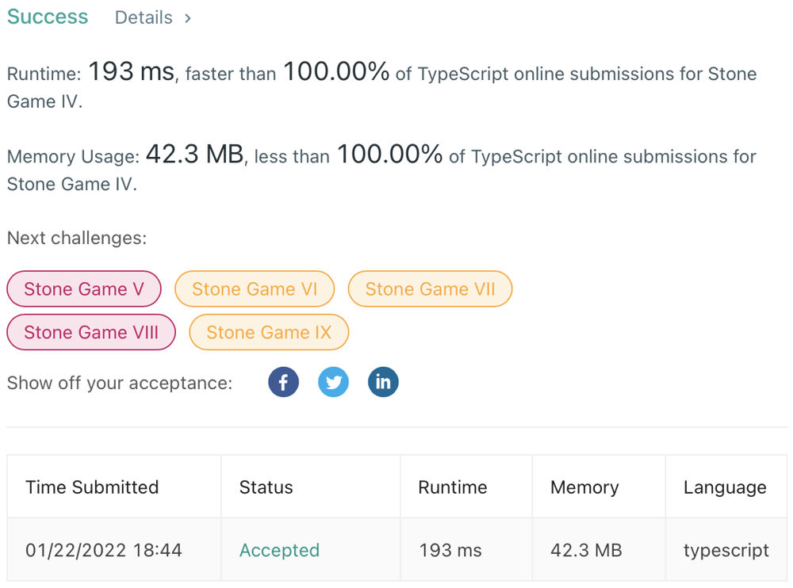

# Javascript & Typescript DP solution with explanation | Time: 100% faster | Memory: 100% less

**Author:** JinZihang
**Votes:** 0
**Link:** [https://leetcode.com/problems/stone-game-iv/solutions/1709092/](https://leetcode.com/problems/stone-game-iv/solutions/1709092/)

---



```
function winnerSquareGame(n: number): boolean {
    // res stores the gaming results of starting with differnt stones
    const res: boolean[] = new Array(n + 1).fill(false);
    let k: number = 1;
    
    // Find out the winning and losing situation from 1 stone to n stones
	// 0 is skipped since n starts from 1
    for (let i: number = 1; i <= n; i++) {
        // If n is a square number, Alice obviously win
        if (k * k === i) {
            res[i] = true;
            k++;
            continue;
        }
        
        // After Alice removes j * j (1 <= j < k) stones,
        // find out whether res[remianignStones] = res[i - j * j]
        // is true of false (whether Bob will win or lose)
        // If there exists a j such that Bob will lose, Alice will win
        for (let j: number = 1; j < k && j * j <= i; j++) {
            if (!res[i - j * j]) {
                res[i] = true;
                break;
            }
        }
    }
    
    return res[n];
};
```