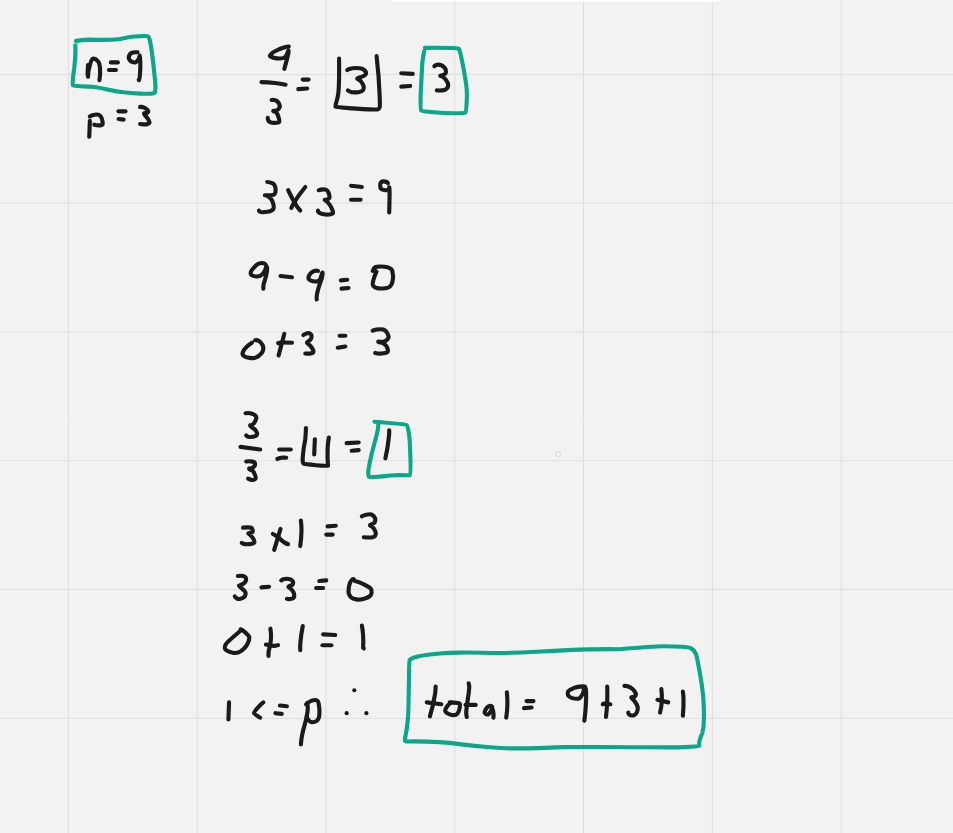

# Dart Solution

**Author:** Friendlygecko
**Votes:** 1
**Link:** [https://leetcode.com/problems/water-bottles/solutions/4907698/](https://leetcode.com/problems/water-bottles/solutions/4907698/)

---

# Intuition
<!-- Describe your first thoughts on how to solve this problem. -->

# Approach
<!-- Describe your approach to solving the problem. -->

# Complexity
- Time complexity:
<!-- Add your time complexity here, e.g. $$O(n)$$ -->

- Space complexity:
<!-- Add your space complexity here, e.g. $$O(n)$$ -->

# Code
```
class Solution {
    int numWaterBottles(int numBottles, int numExchange) {
        final originalNumBottles = numBottles;
        var total = 0;
        while (numBottles >= numExchange) {
            final quotient = (numBottles / numExchange).floor();
            total += quotient;
            final b = quotient * numExchange;
            final left = numBottles - b;
            numBottles = quotient + left;
        }

        return total + originalNumBottles;
    }
}
```

