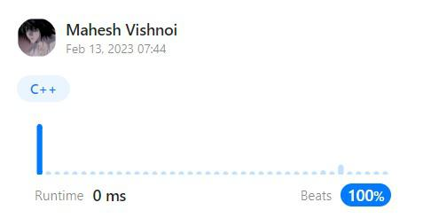

# ✅ [C++]|one line|BEATS 100% Runtime||Explanation✅

**Author:** vishnoi29
**Votes:** 199
**Link:** [https://leetcode.com/problems/count-odd-numbers-in-an-interval-range/solutions/3178206/](https://leetcode.com/problems/count-odd-numbers-in-an-interval-range/solutions/3178206/)

---

\uD83C\uDFA5\uD83D\uDD25 Exciting News! Join my Coding Journey! Subscribe Now! \uD83D\uDD25\uD83C\uDFA5

\uD83D\uDD17 Link in the leetcode profile 

New coding channel alert! \uD83D\uDE80\uD83D\uDCBB Subscribe to unlock amazing coding content and tutorials. Help me reach 1K subs to start posting more videos! Join now! \uD83C\uDF1F\uD83D\uDCAA

Thanks for your support! \uD83D\uDE4F\uD83C\uDF89

# Intuition
we will calculate all odd number from 1 to low-1 and 1 to high;
why low-1??
because we want include our low value.

# Approach
1. Total odd number between 1 and low - 1 is` low/2.`
2. Total odd number between 1 and high is `(high + 1 ) / 2`.
3. For getting answer we will  do
   `Total odd number between 1 and high`  - `Total odd number between 1 and low - 1`
      

# Complexity
- Time complexity:O(1)
- Space complexity:O(1)



# Code
```
class Solution {
public:
    int countOdds(int l, int h) {
        return ((h + 1) / 2) - (l / 2);
    }
};
```

If you really found my solution helpful **please upvote it** , as it motivates me to post such kind of codes.
*Let me know in comment if i can do better*.
Let's Connect on **[LINKDIN](https://www.linkedin.com/in/mahesh-vishnoi-a4a47a193/)**


