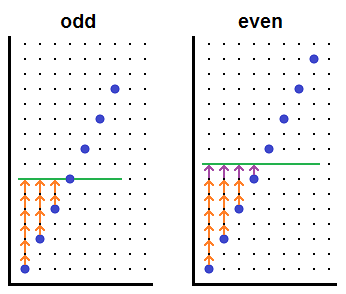
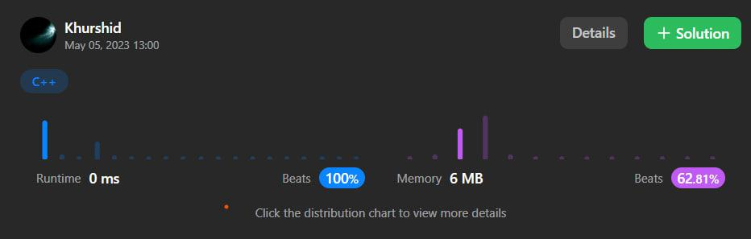

# ✅ C++✅C# ✅ JavaScript.The shortest solutions are there.

**Author:** aloneguy
**Votes:** 12
**Link:** [https://leetcode.com/problems/minimum-operations-to-make-array-equal/solutions/3488289/](https://leetcode.com/problems/minimum-operations-to-make-array-equal/solutions/3488289/)

---

# Intuition:

if you think of the array as points forming a line on a graph, then you can think of that line as the diagonal of a box of area n * 2n, or 2n^2. If you then think of the triangle of moves that have to be made, you can note that the area of said triangle is 1/8th the area of the box, or 2n^2 / 8, or n^2 / 4
<!-- Describe your first thoughts on how to solve this problem. -->


```javascript []
var minOperations = (n) =>n*n/4; 
```
```C++ []
class Solution {
public:
    int minOperations(int n) {
       return n*n/4; 
    }
};
```
```C# []
public class Solution {

    public int MinOperations(int n) => n*n/4;

}
```


