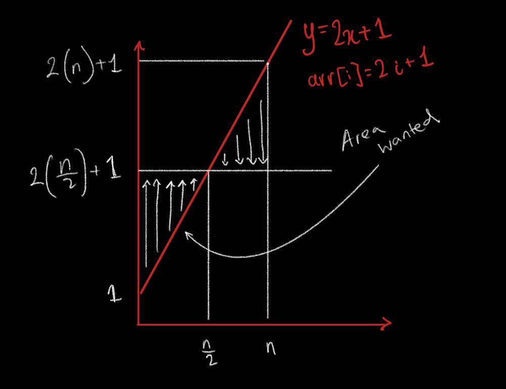

# Golang Simple Solution

**Author:** fcmdias
**Votes:** 2
**Link:** [https://leetcode.com/problems/minimum-operations-to-make-array-equal/solutions/2570561/](https://leetcode.com/problems/minimum-operations-to-make-array-equal/solutions/2570561/)

---


## Area created by lines 


Area created by lines:
y = 2x + 1 (arr[i]=2x+1) 
y-axis 
y = n/2

height = y2-y1
			=(2(n/2) + 1) - (2(0)+1)
			= n
width = x1-x2 
			= n/2 - 0
			= n/2
			
triangle area   = (height * width)/2 
						= (n * n/2 ) / 2 
						= (n*n) / 4


```
func minOperations(n int) int {
    return (n * n  / 4 )
}
```