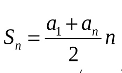

# [Python] O(1) solution using math

**Author:** Mark_computer
**Votes:** 12
**Link:** [https://leetcode.com/problems/minimum-operations-to-make-array-equal/solutions/2846613/](https://leetcode.com/problems/minimum-operations-to-make-array-equal/solutions/2846613/)

---

# Code
```python []
class Solution:
    def minOperations(self, n: int) -> int:
        return (n ** 2) // 4
```
# Approach
If we look attentively, we'll discover that the array arr is a sequence of odd numbers.
First, I tried to find any rule or regularity in answers, and I nociced that we should do all operations and as a result bring all numbers to a single one (for ex. if n = 3: arr = [1, 3, 5], we make arr = [3, 3, 3], we bring all numbers to 3; if n = 4: arr = [1, 3, 5, 7] and we bring all numbers to 4: arr becomes [4, 4, 4, 4] etc.). And as you can notice if n is odd (in this ex. 3) this resulting number is n itself (3). If n is even (4 in this ex.) the resulting number is also n itself (4). So that means we need to bring all numbers to n by using operations. But how to calculate the minimum number of operations? Let's again look at the previous example. 
If n = 4 (n is even): arr = [1, 3, 5, 7]. 
First, we make 3 and 5 become 4 by one opeartion (3 += 1 and 5 -= 1), then 1 and 7 become 4 by three operations (just do 1 += 1 and 7 -= 1 three times). So we have total 1 + 3 (**it's an arithmetic sequence with step 2 starting with 1**) operations.
For ex. if n = 5 (n is odd): arr = [1, 3, 5, 7, 9].
Since 5 is already there we move on and make 3 and 7 become 5 by two operations (3 += 1 and 7 -= 1 two times). Then 1 and 9 become 5 by four operations (1 += 1 and 9 -= 1 four times). So we get in total 2 + 4 operations (**also arithmetic sequence with also step 2, but starting with 2**.)
We see the regularity: 
1) **If n is odd we should calculate the sum of arithmetic sequence with the step 2 and which starts with 2 upto n - 1 (arithmetic sequence = [2, 4, 6, 8, ..., n - 1]).** 
2) **If n is even we should calculate the sum of arithmetic sequence with the step 2 and which starts with 1 upto n - 1 (arithmetic sequence = [1, 3, 5, 7, ..., n - 1]).**
 
We can simply calculate those sums by using formula for finding the sum of arithmetic sequence:

, where a1 - first element, an - last element, n - quantity of elements. 
So for the case when n is odd: 
a1 = 2, 
an = n - 1,
n = n // 2 (since the sequence has the step 2)

And for the case when n is even:
a1 = 1, 
an = n - 1, 
n = n // 2 (since the sequence also has the step 2). 

Therefore if n is odd: result1 = (2 + (n - 1)) * (n // 2) / 2; 
and if n is even: result2 = (1 + (n - 1) * (n // 2) / 2. 
By simplifying we get: result1 = (n + 1) * (n // 2) / 2, result2 = n * (n // 2) / 2. We could stop here but let's try to think more.
We can notice that if n is odd then n // 2 = (n - 1) / 2 therefore result1 = (n + 1) * (n - 1) / 2 / 2. By simplifying we get result1 = (n ** 2 - 1) / 4. 
Then we can notice that if n is even then n // 2 = n / 2 therefore also by simplifying result2 we get: result2 = (n ** 2) / 4. We can see that if n is odd then n ** 2 is also odd therefore n ** 2 will not be divided wholly by 4 and that's why we subtract one from it, but since we just need the whole part we can simply get: result1 = (n ** 2) // 4. By the same logic we get result2 = (n ** 2) // 4. So in both cases the answer is the same so we just return  (n ** 2) // 4.

# Complexity
- Time complexity:
O(1)

- Space complexity:
O(1)