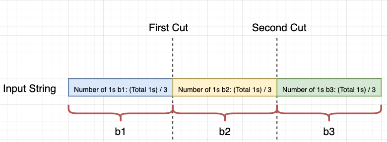
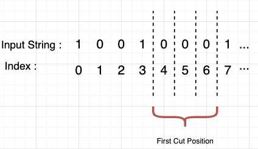
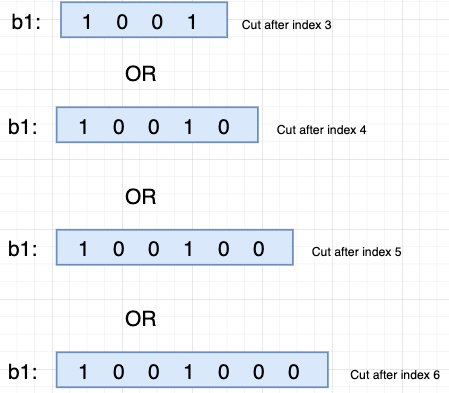
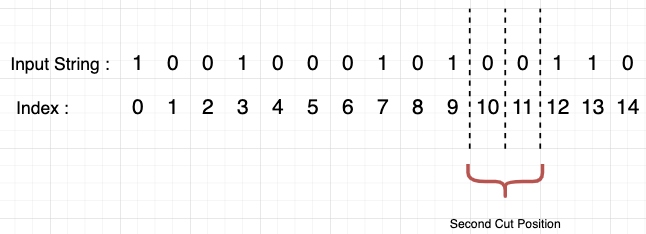

# [Java/Python 3] Multiplication of the ways of 1st and 2nd cuts w/ explanation and analysis.

**Author:** rock
**Votes:** 230
**Link:** [https://leetcode.com/problems/number-of-ways-to-split-a-string/solutions/830455/](https://leetcode.com/problems/number-of-ways-to-split-a-string/solutions/830455/)

---

Please refer to the outstanding elaboration from `@lionkingeatapple`, who deserves more upvotes than me:

----

We have three different scenarios.

`scenarios_1:` If the total number of ones in the input string is not the multiple of three, there is no way we can cut the string into three blocks with an equal number of ones. `=> Count the total number of the 1s, if not divisible by 3, then return 0;`

`scenarios_2:` If give input string are all zeros, it doesn't matter how you want to cut, and each block will have the same number of ones. In other words, the number of ones equals zero in each block. Therefore, the total number of ways to cut the input string is `(n - 2) + (n - 3) + ... + 2 + 1 = (n - 2) * (n - 1) / 2`. (Please reference the proof from @rock explanation).

`scenarios_3:` This is a more general situation. First, think about it, in order to cut the input string to three parts, we need only two cuts, so we can get three blocks. Let's say these three blocks are `b1, b2, b3`. Now, we want the number of ones to be equal for all three blocks and the number of ones we need for each block is `total number of ones / 3`. The questions now become where we need to do our cut, remember we need to only two cuts to make three blocks, so we need to decide where we need to do our first cut, and where we can do our second cut, with all of these we can know our final answer.




Starts from begin of the input string, we can not cut until the number of ones in the substring is less than `total number of ones / 3`. If the number of ones in the substring is equal to `total number of ones / 3`, then that is our place to do the first cut. For example, we have an input string 100100010100110. The number of ones for each block will be `total number of ones / 3 = 6 / 3 = 2`. The first cut place can be either after index `3,4,5 and 6` because of those substrings `( substring(0, 4), substring(0, 5), substring(0, 6), substring(0, 7)` will have the same number of ones, which is `2` and the number of ways to cut at first place is `4` (see diagram below).


**Our first block (b1) could be either one of them below:**



After, we know about our first places to cut the input string, we need to know the second place to cut. When it comes to the second block, the number of ones we want are `the number of ones in the first block + the number of ones in the second block = 1s in b1 + 1s in b2.` Based on the example above, `1s in b1 + 1s in b2 = 2 + 2 = 4`, since the ones between blocks are equal, we can also simply do `2 * (number of ones each block) = 2 * 2 = 4`. Therefore, we need to find the substring with the total number of ones is equal to `4`. Those substrings are `substring(0, 10), substring(0, 11), substring(0, 12)` and our second cut places can be either after index `9, 10, 11` and the number of ways to cut at second place is `3`. (see diagram below)




Finally, after two cuts, we got our `3 blocks` and we have known all the places we can do these two cuts, so we can calculate the total ways of cutting are `number of ways to cut at first place x number of ways to cut at second place = 4 x 3 = 12`.

**Follow up question**
`Return number of ways split input string s into N non-empty strings, each string has an equal number of ones. (2 < N < length of input string)`

Thinking:
In order to have `N` substrings, we need to cut input string `N - 1` times, so we will have `N - 1` blocks. Then, we have `b1, b2, b3, b4, ... ...b(n-1)`. Each of the blocks needs to have `number of ones = total number of ones / N`. And let's assume the number of ways to split string for each cut is `Wi`, so the total number of ways to cut will be `W1 x W2 x W3 x ... ...x Wn-1`. I didn't code this yet. I think you guys are smart enough to get an answer.

----

1. Count the total number of the  `1`s, if not divisible by `3`, then return `0`;
2. If the count is `0`, then we can choose 1st `0` as our 1st cut, correspondingly, the 2nd cut between the other `2` non-empty subarrays will have `n - 2` options, where `n = s.length()`; Similarly, we can also choose  2nd `0` as 1st cut, then we have `n - 3` options for the 2nd cut, ..., etc, totally, the result is `(n - 2) + (n - 3) + ... + 2 + 1 = (n - 2) * (n - 1) / 2`;
3. Otherwise, traverse the input array: count the `1`s again, if the count reaches the `1 / 3` of the totoal number of `1`s, we begin to accumulate the number of the ways of the 1st cut, until the count is greater than `1 / 3 * total ones`; when the count reaches the `2 / 3` of the total number of the `1`s, start to accumulate the number of the ways of the 2nd cut, until the count is greater than `2 / 3 * total ones`;
4. Multification of the numbers of the ways of 1st and 2nd cuts is the result..

```java
    private static final int m = 1_000_000_007;
    public int numWays(String s) {
        int ones = 0, n = s.length();
        for (int i = 0; i < n; ++i) {
            ones += s.charAt(i) - '0';
        }
        if (ones == 0) {
            return (int)((n - 2L) * (n - 1L) / 2 % m);
        }
        if (ones % 3 != 0) {
            return 0;
        }
        int onesInEachSplitedBlock = ones / 3;
        long waysOfFirstCut = 0, waysOfSecondCut = 0;
        for (int i = 0, count = 0; i < n; ++i) {
            count += s.charAt(i) - '0';
            if (count == onesInEachSplitedBlock) {
                ++waysOfFirstCut;
            }else if (count == 2 * onesInEachSplitedBlock) {
                ++waysOfSecondCut;
            }
        }
        return (int)(waysOfFirstCut * waysOfSecondCut % m);        
```
```python
    def numWays(self, s: str) -> int:
        ones, n, m = s.count('1'), len(s), 10 ** 9 + 7
        if ones == 0:
            return (n - 2) * (n - 1) // 2 % m
        if ones % 3 != 0:
            return 0
        ones_in_each_splited_block = ones // 3
        count = ways_of_first_cut = ways_of_second_cut = 0
        for char in s:
            if char == '1':
                count += 1
            if count == ones_in_each_splited_block:
                ways_of_first_cut += 1
            elif count == 2 * ones_in_each_splited_block:
                ways_of_second_cut += 1
        return ways_of_first_cut * ways_of_second_cut % m        
```
**Analysis:**

Two Pass.

Time: O(n), space: O(1), where n = s.length().