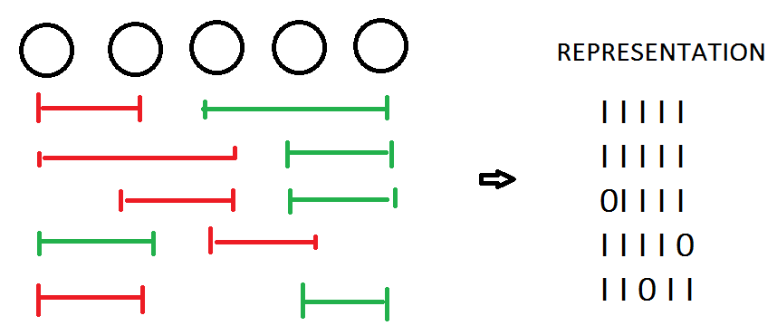
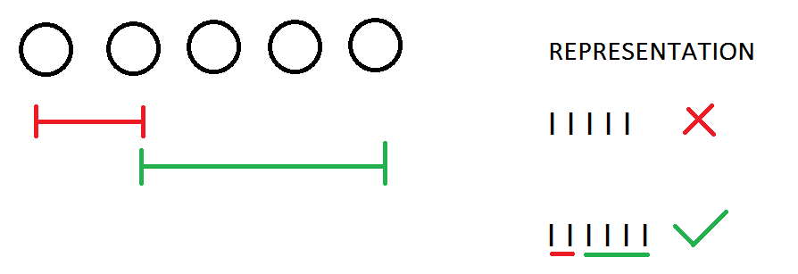
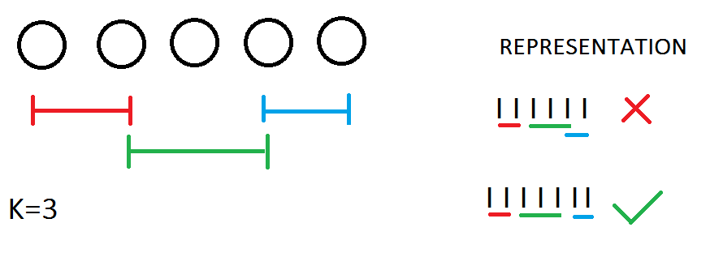

# [Javascript] Combinations explanation + visualization

**Author:** George_Chrysochoou
**Votes:** 17
**Link:** [https://leetcode.com/problems/number-of-sets-of-k-non-overlapping-line-segments/solutions/903611/](https://leetcode.com/problems/number-of-sets-of-k-non-overlapping-line-segments/solutions/903611/)

---

Let us first consider how easy this would be if the segments did not share endpoints. 
Given `n` elements, I would just have to choose` k` segments, that would mean` 2*k` points 
as each segment occupies 1 element for its start, and 1 for its end.
So the result reduces to the **number of Combinations( n choose 2k)**. 
As an example, consider `n=5` elements, and `k=2` segments. 



It is easy to see, that not only is Combinations(5 choose 2\\*2=4) = 5,
but all of the different choices can be represented with 1s and 0s, for occupied and free elements respectively.
So what bugs us is that, since my segments can share endpoints, 
I cant really represent my solution with 1s and 0s, cos I dont have enough free elements as is. 


So in this case, I needed to add an extra k-1=2-1=1 free space, in order for me to be able to represent my choice of segments.
However, if k = 3, 1 extra space wouldnt suffice because there is a case where all of my segments share endpoints.

As you can see, in this case I need k-1=2 extra spaces in order to represent my choice.
Overall one can deduce, that any selection can be represented with n + k-1 bits, n for the elements themselves, and k-1 for 
the extra spaces the sharing endpoints can occupy. So the question now becomes, out of these n+k-1 places, **how many ways are there to choose 2\\*k of them?** That translates to choosing one for the start and one for the end for each of my segments, and is trivially the number of combinations(n+k-1 choose 2\\*k)

The dynamic programming approach exploits a known mathematical formula in order to compute the required combination,

which can be tabulated as            ` dp[i][k]=dp[i-1][k-1]+dp[i-1][k]   `       


```
var numberOfSets = function(n, k) {
    return combinations(n+k-1,2*k)%(1e9+7)
};
var combinations=(n,k)=>{
    var dp=[...Array(n+1)].map(d=>[...Array(k+1)].map(d=>1))
    for (let i = 1; i <=n; i++) 
        for (let k = 1; k <i; k++)
            dp[i][k]=(dp[i-1][k-1]+dp[i-1][k]) %(1e9+7)     
    return dp[n][k]
}
```