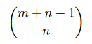
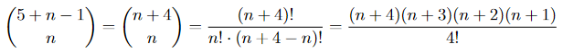

# One line, O(1) space/time, no DP/strings

**Author:** anikit
**Votes:** 11
**Link:** [https://leetcode.com/problems/count-sorted-vowel-strings/solutions/2028984/](https://leetcode.com/problems/count-sorted-vowel-strings/solutions/2028984/)

---

**Solution**

```csharp
public int CountVowelStrings(int n) =>
    (n + 1) * (n + 2) * (n + 3) * (n + 4) / 24;
```

**Explanation**

This is a pure math exercise with a single variable, so using DP or actually constructing strings is an overkill. Here is the formula to count [combinations with repetitions](https://math.stackexchange.com/questions/208377/combination-with-repetitions):

where `m` is the number of distinct objects at our disposal and `n` is how many we can take.

In this case, we have 5 vowels to choose from, so `m = 5`. We proceed like this:


