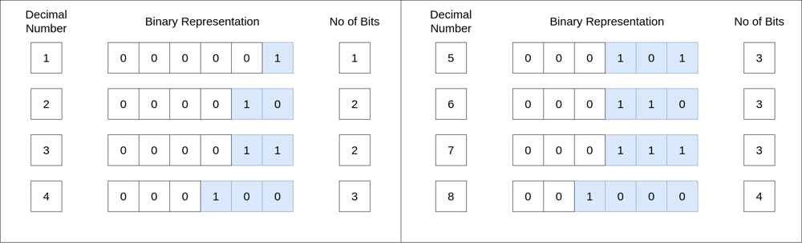
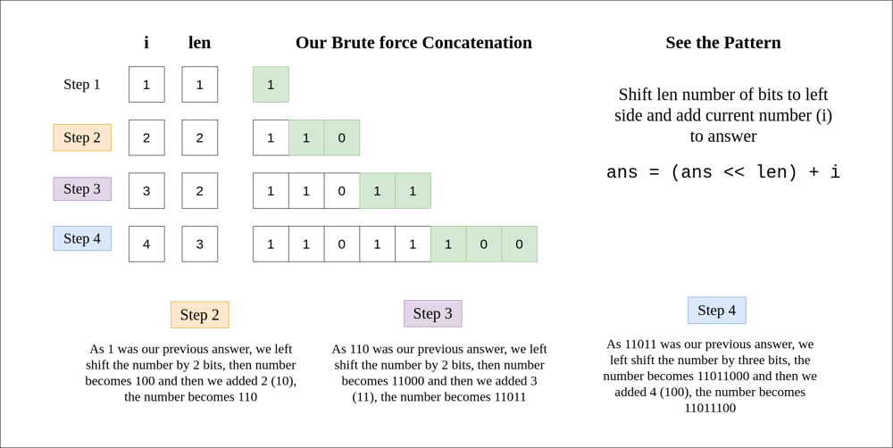

# C++ | Diagram | Related Problems

**Author:** kiranpalsingh1806
**Votes:** 339
**Link:** [https://leetcode.com/problems/concatenation-of-consecutive-binary-numbers/solutions/2612407/](https://leetcode.com/problems/concatenation-of-consecutive-binary-numbers/solutions/2612407/)

---






```cpp
class Solution {
public:
    
    int numberOfBits(int n) {
		  return log2(n) + 1;
    }
    
    int concatenatedBinary(int n) {
        long ans = 0, MOD = 1e9 + 7;
        
        for (int i = 1; i <= n; ++i) {
            int len = numberOfBits(i);
            ans = ((ans << len) % MOD + i) % MOD;
        }
        return ans;
    }
};
```

**EDIT 1**
**Optimization** in `numberOfBits` function
```cpp
int numberOfBits(int n) {
   int leadingZeros = __builtin_clz(n);
   return 32 - leadingZeros;
}
```

**EDIT 2**
Another way of **calculating length of binary number** suggested by @CoolBud
```cpp
int numberOfBits(int n) {
    return log2(n) + 1;
}
```

**EDIT 3**
Another way of **calculating length of binary number** suggested by @Sopindm
```cpp
int concatenatedBinary(int n) {
        long ans = 0, MOD = 1e9 + 7, len = 0;
        for (int i = 1; i <= n; ++i) {
            if(__builtin_popcount(i) == 1) ++len;
            ans = ((ans << len) % MOD + i) % MOD;
        }
        return ans;
}
```

**Binary Representation Related Problems**
[1. Add Binary ](https://leetcode.com/problems/add-binary/)
[2. Add Two Numbers ](https://leetcode.com/problems/add-two-numbers/)
[3. Counting Bits ](https://leetcode.com/problems/counting-bits/)
[4. Binary Watch ](https://leetcode.com/problems/binary-watch/)
[5. Reverse Bits ](https://leetcode.com/problems/reverse-bits/)
[6. Binary Number with Alternating Bits ](https://leetcode.com/problems/binary-number-with-alternating-bits/)
[7. Hamming Distance ](https://leetcode.com/problems/hamming-distance/)
[8. Prime Number of Set Bits in Binary Representation ](https://leetcode.com/problems/prime-number-of-set-bits-in-binary-representation/)