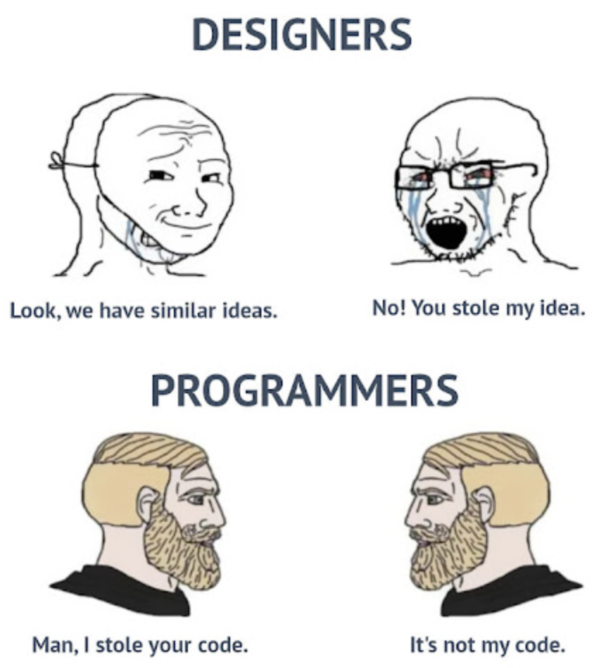

# 🥇 return N-1 ; ]

**Author:** karan_8082
**Votes:** 79
**Link:** [https://leetcode.com/problems/count-of-matches-in-tournament/solutions/4363375/](https://leetcode.com/problems/count-of-matches-in-tournament/solutions/4363375/)

---


**Upvote If You Like the IDEA**

There are `n` teams participating in the tournament.
After each match `1` team is eliminated.
`n-1` teams needs to be eliminated: hence `n-1` matches.


# Complexity
- Time complexity: O(1)

- Space complexity: O(1)

``` Python []
class Solution:
    def numberOfMatches(self, n: int) -> int:
        return n-1
```
``` C++ []
class Solution {
public:
    int numberOfMatches(int n) {
        return n - 1;
    }
};
```
``` JAVA []
class Solution {
    public int numberOfMatches(int n) {
        return n - 1;
    }
}
```

# ORRRR
Make `res = 0`
- `res += (n // 2)`
- `n = (n // 2) + 1`   : if `n % 2 == 1`
- `n = (n // 2)`   : if `n % 2 == 0`
- Repeat till `n` > 1
O(log n)




**UPVOTE IF HELPFuuL**