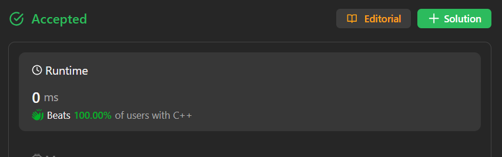

# 🚀✅🚀 100% beats || One line || Easy peasy || Java, Python, C#, Rust, Ruby, Go, C, C++, Php|| 🔥🔥

**Author:** ilxamovic
**Votes:** 8
**Link:** [https://leetcode.com/problems/count-of-matches-in-tournament/solutions/4364006/](https://leetcode.com/problems/count-of-matches-in-tournament/solutions/4364006/)

---




# Intuition
The solution is based on the observation that, in each round of the tournament, one team is eliminated, except in the final round where the winner is decided. Therefore, the number of matches played until a winner is decided is equal to the number of teams minus one.

# Approach
The approach is straightforward. We initialize a variable `matches` to 0 and then iterate through the tournament rounds. In each round, we eliminate one team and increment the `matches` counter. This process continues until there is only one team left as the winner.

# Complexity
- **Time complexity:** O(1)
  - The time complexity is constant as the solution involves a simple arithmetic operation (subtraction) regardless of the value of n.

- **Space complexity:** O(1)
  - The space complexity is constant as there is no additional space used that depends on the input size.

```python []
class Solution:
    def numberOfMatches(self, n: int) -> int:
        return n - 1
```
```C# []
public class Solution {
    public int NumberOfMatches(int n) {
        return n - 1;
    }
}
```
``` Java []
public class Solution {
    public int numberOfMatches(int n) {
        return n - 1;
    }
}
```
```Rust []
impl Solution {
    pub fn number_of_matches(n: i32) -> i32 {
        n - 1
    }
}
```
``` Php []
class Solution {
    function numberOfMatches($n) {
        return $n - 1;
    }
}
```
```Ruby []
def number_of_matches(n)
    n - 1
end
```
``` Go []
func numberOfMatches(n int) int {
    return n - 1
}
```
```C []
int numberOfMatches(int n){
    return n - 1;
}
```
``` C++ []
class Solution {
public:
    int numberOfMatches(int n) {
        return n - 1;
    }
};
```


- Please upvote me !!!