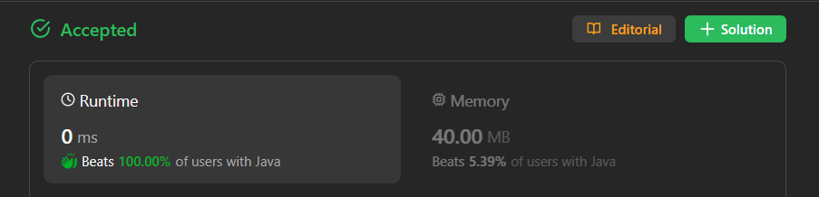

# ❌(N-1) is Not a Interview Solution - ✅ Look how to explain in Interviews

**Author:** lancertech6
**Votes:** 41
**Link:** [https://leetcode.com/problems/count-of-matches-in-tournament/solutions/4365160/](https://leetcode.com/problems/count-of-matches-in-tournament/solutions/4365160/)

---



# YouTube Video Explanation:

[https://youtu.be/UGxydesUE9k](https://youtu.be/UGxydesUE9k)
<!-- **If you want a video for this question please write in the comments** -->

**\uD83D\uDD25 Please like, share, and subscribe to support our channel's mission of making complex concepts easy to understand.**

Subscribe Link: https://www.youtube.com/@leetlogics/?sub_confirmation=1

*Subscribe Goal: 700 Subscribers*
*Current Subscribers: 593*

---
# Example Explanation
**N=7**

| Round | Number of Teams (n) | Matches Played | Total Matches |
|-------|----------------------|-----------------|---------------|
|   1   |           7          |        3        |       3       |
|   2   |           4          |        2        |       5       |
|   3   |           2          |        1        |       6       |

| Round 1      | Round 2     | Round 3     | Winner      |
|--------------|-------------|-------------|-------------|
| A1 vs. A2 = B1   | B1 vs. B2 = C1  |      C1 vs. C2       |  D1           |
| A3 vs. A4 = B2 |    B3 vs. A7 = C2 |             |             |
| A5 vs. A6 = B3 |             |             |             |
| A7           |             |             |             |


**Explanation:**
- **Round 1:**
  - Number of teams at the beginning = 7
  - Matches played in this round = 3 (\u230A7/2\u230B)
  - Total matches after Round 1 = 3

- **Round 2:**
  - Number of teams at the beginning = 4
  - Matches played in this round = 2 (\u230A4/2\u230B)
  - Total matches after Round 2 = 3 + 2 = 5

- **Round 3:**
  - Number of teams at the beginning = 2
  - Matches played in this round = 1 (\u230A2/2\u230B)
  - Total matches after Round 3 = 5 + 1 = 6

The algorithm stops when there is only one winning team.

This table summarizes the main steps of the algorithm, demonstrating how the number of matches is calculated in each round and how the number of teams is updated.

---
# Intuition
<!-- Describe your first thoughts on how to solve this problem. -->
The problem requires determining the number of matches played in a tournament with specific rules. If the number of teams is even, half of them advance to the next round, and if it's odd, one team advances while the rest get paired. The goal is to calculate the total number of matches until a winner is decided.

# Approach
<!-- Describe your approach to solving the problem. -->
The algorithm utilizes a while loop to iterate until there is only one winning team. In each iteration, it calculates the number of matches played in the current round and updates the total count. It then adjusts the number of teams for the next round based on the tournament rules.

1. Initialize a variable `count` to keep track of the total matches played.
2. Use a while loop with the condition `n > 1` to iterate until there is only one winning team.
3. In each iteration:
   - Calculate the number of matches played in the current round as `n / 2`.
   - Update the total count by adding the matches played in the current round.
   - Adjust the number of teams for the next round by setting `n` to `n - (n / 2)`.

# Complexity
- The time complexity is O(log n), where n is the number of teams. In each iteration, the number of teams is halved.
- The space complexity is O(1) since the algorithm uses a constant amount of extra space.

# Code
```java []
class Solution {
    public int numberOfMatches(int n) {
        int count = 0;
        int rev = 0;
        while(n>1) {
            rev = n/2;
            count+=rev;
            n=n-rev;
        }
        return count;
    }
}
```
```C++ []
class Solution {
public:
    int numberOfMatches(int n) {
        int count = 0;
        int rev = 0;
        while(n > 1) {
            rev = n / 2;
            count += rev;
            n = n - rev;
        }
        return count;
    }
};
```
```Python []
class Solution(object):
    def numberOfMatches(self, n):
        count = 0
        while n > 1:
            rev = n // 2
            count += rev
            n = n - rev
        return count
        
```
```JavaScript []
/**
 * @param {number} n
 * @return {number}
 */
var numberOfMatches = function(n) {
    let count = 0;
    let rev = 0;
    while (n > 1) {
        rev = Math.floor(n / 2);
        count += rev;
        n = n - rev;
    }
    return count;
};
```

