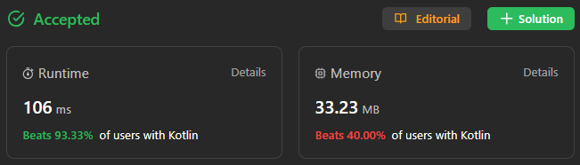

# ✅ 93% 🔮 no loop || O(1) space & time || sum of arithmetic sequence

**Author:** sunnoca
**Votes:** 1
**Link:** [https://leetcode.com/problems/calculate-money-in-leetcode-bank/solutions/4369323/](https://leetcode.com/problems/calculate-money-in-leetcode-bank/solutions/4369323/)

---

# Please Upvote \uD83D\uDD1D Appreciations!


# Code
``` Kotlin []
class Solution {
    fun totalMoney(n: Int): Int {
        val f = n / 7  // full week
        val d = n % 7  // not full week days
        return (7 * f * (f + 7) + (2 * f + d + 1) * d) / 2
    }
}
```
``` Kotlin []
class Solution {
    fun totalMoney(n: Int): Int {
        val f = n / 7  // full week
        val d = n % 7  // not full week days
        val full = 7 * f * (f + 7)
        val diff = (f + f + d + 1) * d
        return (full + diff).shr(1)
    }
}
```
# Complexity
- Time complexity: **O(** 1 **)**
- Space complexity: **O(** 1 **)**
