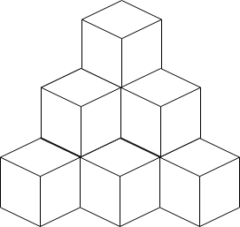

# [1739. Building Boxes](https://leetcode.com/problems/building-boxes/)

| Category | Difficulty | Likes | Dislikes |
| :------: | :--------: | :---: | :------: |
| Algorithms | Hard | 313 | 49 |

**Tags:** [`math`](https://leetcode.com/tag/math), [`binary-search`](https://leetcode.com/tag/binary-search), [`greedy`](https://leetcode.com/tag/greedy)


## Description

You have a cubic storeroom where the width, length, and height of the room are all equal to `n` units. You are asked to place `n` boxes in this room where each box is a cube of unit side length. There are however some rules to placing the boxes:

	- You can place the boxes anywhere on the floor.

	- If box `x` is placed on top of the box `y`, then each side of the four vertical sides of the box `y` **must** either be adjacent to another box or to a wall.

Given an integer `n`, return* the **minimum** possible number of boxes touching the floor.*

 

**Example 1:**


```

Input: n = 3
Output: 3
Explanation: The figure above is for the placement of the three boxes.
These boxes are placed in the corner of the room, where the corner is on the left side.

```

**Example 2:**


```

Input: n = 4
Output: 3
Explanation: The figure above is for the placement of the four boxes.
These boxes are placed in the corner of the room, where the corner is on the left side.

```

**Example 3:**



```

Input: n = 10
Output: 6
Explanation: The figure above is for the placement of the ten boxes.
These boxes are placed in the corner of the room, where the corner is on the back side.
```

 

**Constraints:**

	- `1 <= n <= 10^9`

---

**Links:** [Submissions](https://leetcode.com/problems/building-boxes/) | [Solutions](https://leetcode.com/problems/building-boxes/)
