# [C++] O(1), ~0ms, no loop, math solution with detailed explanation

**Author:** user4517
**Votes:** 11
**Link:** [https://leetcode.com/problems/building-boxes/solutions/1288308/](https://leetcode.com/problems/building-boxes/solutions/1288308/)

---

I did quite some math and came up with this solution that avoid searching. Hope these explanations help.

**Time complexity: O(1)
Space complexity : O(1)**

First, we observe the relationship between ```n``` and the minimum possible number of boxes touching the floor (denoted as `Z`).
`n` 1 | &nbsp; 2&nbsp; 3  &nbsp;4 |  &nbsp;5  &nbsp;6  &nbsp;7  &nbsp;8  &nbsp;9 &nbsp;10 | 11  12  13  14  15  16  17  18  19  20 | ...
`Z` 1 | &nbsp; 2&nbsp; 3  &nbsp;3 |  &nbsp;4  &nbsp;5  &nbsp;5  &nbsp;6  &nbsp;6 &nbsp; 6&nbsp; |&nbsp; 7  &nbsp; 8 &nbsp; 8 &nbsp; 9 &nbsp; 9 &nbsp; 9 &nbsp;10  10  10  10 | ...

At `n = 1, 4, 10, 20...`, we can build a "perfect pyramid" of height `h = 1, 2, 3, 4...`.
A **perfect pyramid** has `1+2+3+...+i` at Layer `i` (as the following figure shows).
Therefore, the perfect pyramid with height `h` have the box number of `1 + (1+2) + (1+2+3) + ... (1+2+3...+h)`, 
or 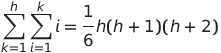 (denoted as `pyramid_box_num`)
Moreover, the perfect pyramid with height `h` have floor-touching box number of  `(1+2+3...+h)` (denoted as `pyramid_base_num`)

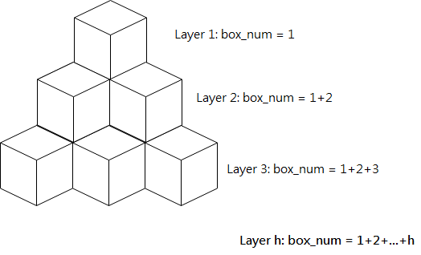
\\---------------------------------------------------------------------------------------------
When we add more boxes to the room, we can follow a specific order (shown in the following figure) to minimize the number of boxes touching the floor. We can see the relationship between the added number of box `+k` and the added number of boxes touching the floor `+z`.
`+k` +1 &nbsp; | +2 &nbsp; +3 | &nbsp; +4 &nbsp; +5 &nbsp; +6 &nbsp; | +7 &nbsp; +8 &nbsp; +9 &nbsp;+10
`+z` +1 &nbsp; | +2 &nbsp; +2 | &nbsp; +3 &nbsp; +3 &nbsp; +3 &nbsp; | +4 &nbsp; +4 &nbsp; +4 &nbsp; +4
On top of a "perfect pyramid" with box number = `pyramid_box_num`, we add `k = n-pyramid_box_num` boxes, where `(1+2+...+(z-1)) < k \u2A7D (1+2+...+z)`
or  = `max_box_added`

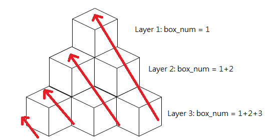
\\---------------------------------------------------------------------------------------------

Now the origial problem becomes two sub-problems:
1. Given a box number `n`, what is the biggest perfect pyramid we can build?
2. On top of the perfect pyramid, how many floor-touching boxes will be added after `+k` boxes is added to the room?

\\---------------------------------------------------------------------------------------------
For the sub-question 1, we have to find the height `h` of the biggest perfect perimid such that:
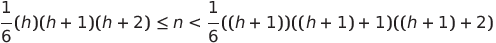

 
 or  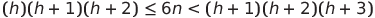
 
 or 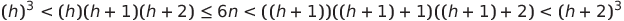

 or 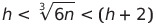


 or 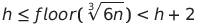


Therefore, 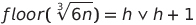, and we have 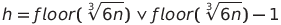


In the code, `h` is determined to be `cbrt((long)6*n)` or `cbrt((long)6*n) - 1` by the condition that `n` have to be smaller than or equal to the box number of the biggest perfect pyramid `pyramid_box_num`.
After getting `h`, we can find the number of floor-touching boxes of the biggest perfect pyramid `pyramid_base_num = (h)*(h+1)/2`.

\\---------------------------------------------------------------------------------------------
After `n -= pyramid_box_num;`, `n` becomes `k` the box number left to be added to the room and there goes the sub-question 2.
From 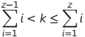, we have 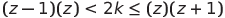

or 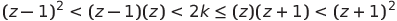 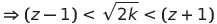

or 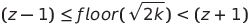

Now, we have `sqrt(2k) = z-1 or z`. In other words, `z = sqrt(2k) or sqrt(2k)+1`.
In the code, `z` is determined to be `sqrt(2k)` or `sqrt(2k)+1` by the condition that `k` have to be smaller than or equal to `max_box_added`.

Finally, the number of boxes touching the floor `Z` is the summation of `pyramid_base_num` from the biggest pyramid and `z` from the remaining boxes added to the room.


```
class Solution {
public:
    int minimumBoxes(int n) {
        
        // Find the biggest perfect pyramid
        uint32_t h = cbrt((long)6*n);
        uint32_t pyramid_box_num = h*(h+1)/2*(h+2)/3;   // /6 is split to /2 and /3 to avoid long to save space
        if ( pyramid_box_num > n ){
            h--;
            pyramid_box_num = h*(h+1)/2*(h+2)/3;            // /6 is split to /2 and /3 to avoid long to save space
        }
        
        // Calculate how many floor-touching boxes in the pyramid
        int pyramid_base_num = (h)*(h+1)/2;
        
        // Get the number of boxes to be added to the perfect pyramid
        n -= pyramid_box_num;
        
        // Find how many floor-touching boxes are added
        int z = sqrt(2*n);
        int max_box_added = z*(z+1)/2;
        if ( max_box_added < n)
            z++;
        
        return pyramid_base_num+z;
    }
};
```