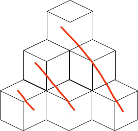

# [C++] my solution w/ some notes, O(n^(1/3))

**Author:** sky_io
**Votes:** 19
**Link:** [https://leetcode.com/problems/building-boxes/solutions/1032051/](https://leetcode.com/problems/building-boxes/solutions/1032051/)

---

> [\u4E2D\u6587\u9898\u89E3](https://www.acwing.com/solution/content/32035/)


* `row`: the level of boxes
* `base`: number of boxes on the floor,  `next_base = cur_base + (row + 1)`

1. we add a level of boxes (`sum += base`) at each loop, till sum greater than or equal to n. (if now sum equals n, just return `base`)
2. now we try to remove a box from the `base` (the boxes on the floor) at each loop (our answer is inside `(pre_base, base)`) till `sum` is less than `n` , then return `base + 1`, or equal to `n`, then return `base` . Each time we remove a box from `base`, we need to remove a row of boxes marked in red line (`sum -= (row--)`).

```c++
class Solution {
 public:
  int minimumBoxes(int n) {
    int sum = 1, base = 1, row = 1;
    while (sum < n) {
      base += (++row);
      sum += base;
    }
    while (sum > n) {
      --base;
      sum -= (row--);
    }
    return base + (sum < n);
  }
};
```

* time complexity: `O(max_row)` which is the smallest `x` that satisfies `x*(x+1)*(x+2)/6>=n`, about `O(n^(1/3))`

	
