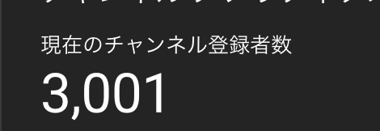

# 【Video】Give me 5 minutes- O(n) time, O(1) space - How we think about a solution

**Author:** niits
**Votes:** 126
**Link:** [https://leetcode.com/problems/count-number-of-homogenous-substrings/solutions/4266765/](https://leetcode.com/problems/count-number-of-homogenous-substrings/solutions/4266765/)

---

# Intuition
Use two pointers to get length of substring

---

# Solution Video

https://youtu.be/VcZrmO045Bo

\u25A0 Timeline of the video

`0:04` Let's find a solution pattern
`1:38` A key point to solve Count Number of Homogenous Substrings
`2:20` Demonstrate how it works with all the same characters
`4:55` What if we find different characters
`7:13` Coding
`8:21` Time Complexity and Space Complexity

### \u2B50\uFE0F\u2B50\uFE0F Don't forget to subscribe to my channel! \u2B50\uFE0F\u2B50\uFE0F

**\u25A0 Subscribe URL**
http://www.youtube.com/channel/UC9RMNwYTL3SXCP6ShLWVFww?sub_confirmation=1

Subscribers: 2,984
My first goal is 10,000 (It's far from done \uD83D\uDE05)
Thank you for your support!

\u3010Updated\u3011

A few minutes ago, I opened youtube studio and my channel reached 3,000 subscribers. Thank you so much for your support!!




---

# Approach

## How we think about a solution

Seems like we have a lot of patterns, so when I feel that, I usually think about output with small input.

```
Input = "a"
```
```
Pattern
"a": 1

Output = 1
```

```
Input = "aa"
```
```
Pattern
"a": 2
"aa": 1

Output = 3
```

```
Input = "aaa"
```
```
Pattern
"a": 3
"aa": 2
"aaa": 1

Output = 6
```
```
Input = "aaaa"
```
```
Pattern
"a": 4
"aa": 3
"aaa": 2
"aaaa": 1

Output = 10
```
```
Input = "aaaaa"
```
```
Pattern
"a": 5
"aa": 4
"aaa": 3
"aaaa": 2
"aaaaa": 1

Output = 15
```

Seems like we have a solution pattern.

---

\u2B50\uFE0F Points

Every time we find the same character, we can accumulate `current length of substring` to `ouput`. We will add the numbers from bottom to top (1 + 2 + 3 + 4 + 5) because when we iterate through the input string, length of substring start from minimum to maximum. We use two pointers for length of subtring. Let's say `left` and `right`

```
"a": 5
"aa": 4
"aaa": 3
"aaaa": 2
"aaaaa": 1 

5 + 4 + 3 + 2 + 1 = 1 + 2 + 3 + 4 + 5

5 + 4 + 3 + 2 + 1 is coming from pyramid above
1 + 2 + 3 + 4 + 5 is actual calculation in solution code
```
They are the same output.

- How can you calculate length of substring?

Simply
```
right - left + 1
```
Why + 1?

That's because `left` and `right` are index number, when both indices are `0`, they are pointing `a`.

```
0 - 0 = 0?
```
That's wrong. We find single `a`. That's why we need to add `+1`.

##### How it works

```
Input: "aaaaa"
```

```
left = 0
right = 0

Find "a"
output: 1

```
```
left = 0
right = 1

output: 3 (1 + 2)

1 is current output
2 is length of substring (= "aa")
```
```
left = 0
right = 2

output: 6 (3 + 3)

(first)3 is current output
(second)3 is length of substring (= "aaa")
```
```
left = 0
right = 3

output: 10 (6 + 4)

6 is current output
4 is length of substring (= "aaaa")
```
```
left = 0
right = 4

output: 15 (10 + 5)

10 is current output
5 is length of substring (= "aaaaa")
```

```
output: 15
```

### What if we find a different character?

When we find the different character, we know that the differnt character is the first new character.

In that case, 

---

\u2B50\uFE0F Points

- We cannot accumulate previous length of subtring anymore, so update `left` with `right`, then we can make a new start from current place

- Add `+1` to current output before we go to the next iteration, because the character is the first character, we know that when we have only one character, output should be `1`. 

---

##### How it works

```
Input: "aabbb"
```
```
left = 0
right = 0

output = 1
```
```
left = 0
right = 1

output = 3 (1 + 2)
1 is current output
2 is length of substring(= "aa")
```
Then we find a different character. `a` vs `b`
```
left = 0
right = 2

output = 4 (3 + 1)
3 is current output
1 is length of substring(= "b")
```
We will make a new start from index `2`, so update `left` with `right`.

```
left = 2
right = 3

output = 6 (4 + 2)
4 is current output
2 is length of substring(= "bb")
```

```
left = 2
right = 4

output = 9 (6 + 3)
6 is current output
3 is length of substring(= "bbb")
```

```
output: 9
```

Easy! \uD83D\uDE04
Let's see a real algorithm!


---

### Algorithm Overview:

Use two pointers to get length of substring, then we will accumulate the length if we find the same characters. If not, we can make a new start.

Let's break it down into more detailed steps:

### Detailed Explanation:

1. Initialize `left` and `res` to 0.

2. Start a loop that iterates through each character in the input string `s`.

3. Check if the character at index `left` is equal to the character at index `right`.

4. If the characters are the same:
   - Increment the result `res` by the length of the current substring, which is `right - left + 1`. This accounts for substrings where all characters are the same.

5. If the characters are different:
   - Increment the result `res` by 1 to account for the single character substring.
   - Update the `left` index to the `right` index to start a new substring.

6. Repeat steps 3 to 5 for all characters in the input string.

7. After the loop is completed, return the result `res` modulo `(10^9 + 7)`.

This algorithm essentially counts the length of consecutive substrings with the same characters within the input string and returns the result modulo `(10^9 + 7)`.

---

# Complexity
- Time complexity: $$O(n)$$
We iterate through all characters one by one.

- Space complexity: $$O(1)$$
We don't use extra data structure.

```python []
class Solution:
    def countHomogenous(self, s: str) -> int:

        left = 0
        res = 0

        for right in range(len(s)):
            if s[left] == s[right]:
                res += right - left + 1
            else:
                res += 1
                left = right
        
        return res % (10**9 + 7)
```
```javascript []
/**
 * @param {string} s
 * @return {number}
 */
var countHomogenous = function(s) {
    let left = 0;
    let res = 0;

    for (let right = 0; right < s.length; right++) {
        if (s[left] === s[right]) {
            res += right - left + 1;
        } else {
            res += 1;
            left = right;
        }
    }

    return res % (Math.pow(10, 9) + 7);    
};
```
```java []
class Solution {
    public int countHomogenous(String s) {
        int left = 0;
        long res = 0;
        
        for (int right = 0; right < s.length(); right++) {
            if (s.charAt(left) == s.charAt(right)) {
                res += right - left + 1;
            } else {
                res += 1;
                left = right;
            }
        }

        return (int) (res % (1000000007));       
    }
}
```
```C++ []
class Solution {
public:
    int countHomogenous(string s) {
        int left = 0;
        long long res = 0;
        
        for (int right = 0; right < s.length(); right++) {
            if (s[left] == s[right]) {
                res += right - left + 1;
            } else {
                res += 1;
                left = right;
            }
        }

        return (int) (res % (1000000007));        
    }
};
```

---

Thank you for reading my post.
\u2B50\uFE0F Please upvote it and don't forget to subscribe to my channel!

\u25A0 Subscribe URL
http://www.youtube.com/channel/UC9RMNwYTL3SXCP6ShLWVFww?sub_confirmation=1

\u25A0 Twitter
https://twitter.com/CodingNinjaAZ


### My next daily coding challenge post and video.

post
https://leetcode.com/problems/restore-the-array-from-adjacent-pairs/solutions/4271506/video-give-me-5-minutes-on-time-and-space-how-we-think-about-a-solution/

video
https://youtu.be/P14SbuALeJ8

\u25A0 Timeline of the video

`0:04` A key point to solve this question
`1:09` How do you know adjacent number of each number?
`2:33` Demonstrate how it works
`6:07` Coding
`9:07` Time Complexity and Space Complexity

### My previous daily coding challenge post and video.

post
https://leetcode.com/problems/eliminate-maximum-number-of-monsters/solutions/4259212/video-give-me-10-minutes-on-solution-how-we-think-about-a-solution/

video
https://youtu.be/7nxGK97CmIw

\u25A0 Timeline of the video

`0:04` How we can calculate x and y distances
`0:55` We need to consider 2 cases and explain what if start and finish cell are the same position
`2:20` Explain case 2, what if start and finish cell are different positions
`4:53` Coding
`6:18` Time Complexity and Space Complexity