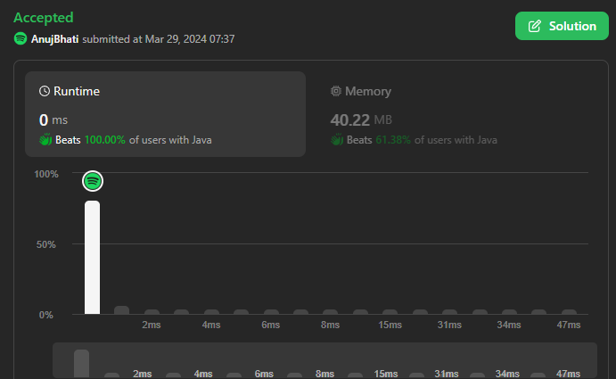
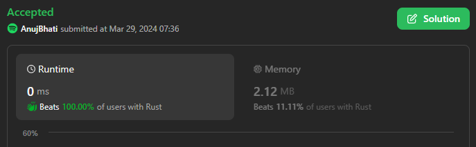
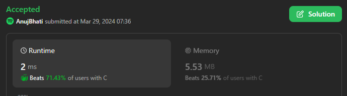

# Easy 9 Languages Solution 1 Linear -- Please upvote beats 100%

**Author:** Edwards310
**Votes:** 2
**Link:** [https://leetcode.com/problems/check-if-number-is-a-sum-of-powers-of-three/solutions/4940013/](https://leetcode.com/problems/check-if-number-is-a-sum-of-powers-of-three/solutions/4940013/)

---

# Intuition



```C++ []
class Solution {
public:
    bool checkPowersOfThree(int n) {
        while (n) {
            int r = n % 3;
            if (r == 2)
                return false;
            n /= 3;
        }
        return true;
    }
};
```
```python3 []
class Solution:
    def checkPowersOfThree(self, n: int) -> bool:
        while n:
            r = n % 3
            if r == 2:
                return False
            n //= 3
        return True
```
```rust []
impl Solution {
    pub fn check_powers_of_three(n: i32) -> bool {
        let mut temp = n;
        while temp > 0 {
            if temp % 3 == 2 {
                return false;
            }
            temp /= 3;
        }
        true
    }
}
```
```javascript []
/**
 * @param {number} n
 * @return {boolean}
 */
var checkPowersOfThree = function (n) {
    while (n) {
        const r = n % 3;
        if (r == 2)
            return false;
        n = (n - r) / 3;
    }
    return true;
};
```
```python []
class Solution(object):
    def checkPowersOfThree(self, n):
        """
        :type n: int
        :rtype: bool
        """
        while n:
            r = n % 3
            if r == 2:
                return False
            n //= 3
        return True
```
```C# []
public class Solution {
    public bool CheckPowersOfThree(int n) {
        while (n != 0) {
            int r = n % 3;
            if (r == 2)
                return false;
            n /= 3;
        }
        return true;
    }
}
```
```Java []
class Solution {
    public boolean checkPowersOfThree(int n) {
        while (n != 0) {
            int r = n % 3;
            if (r == 2)
                return false;
            n /= 3;
        }
        return true;
    }
}
```
```C []
bool checkPowersOfThree(int n) {
    while (n) {
        int r = n % 3;
        if (r == 2)
            return false;
        n /= 3;
    }
    return true;
}
```
```TypeScript []
function checkPowersOfThree(n: number): boolean {
    while (n) {
        const r = n % 3;
        if (r == 2)
            return false;
        n = (n - r) / 3;
    }
    return true;
};
```
<!-- Describe your first thoughts on how to solve this problem. -->

# Approach
<!-- Describe your approach to solving the problem. -->

# Complexity
- Time complexity:
<!-- Add your time complexity here, e.g. $$O(n)$$ -->
    O(n)
- Space complexity:
<!-- Add your space complexity here, e.g. $$O(n)$$ -->
    O(1)
# Code
```
class Solution(object):
    def checkPowersOfThree(self, n):
        """
        :type n: int
        :rtype: bool
        """
        while n:
            r = n % 3
            if r == 2:
                return False
            n //= 3
        return True
```
# Please upvote if it's useful

