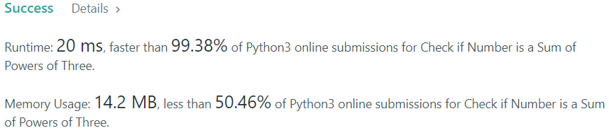

# While loop, 99% speed

**Author:** EvgenySH
**Votes:** 4
**Link:** [https://leetcode.com/problems/check-if-number-is-a-sum-of-powers-of-three/solutions/1341617/](https://leetcode.com/problems/check-if-number-is-a-sum-of-powers-of-three/solutions/1341617/)

---


```
class Solution:
    def checkPowersOfThree(self, n: int) -> bool:
        while n:
            n, rem = divmod(n, 3)
            if rem == 2:
                return False
        return True
```