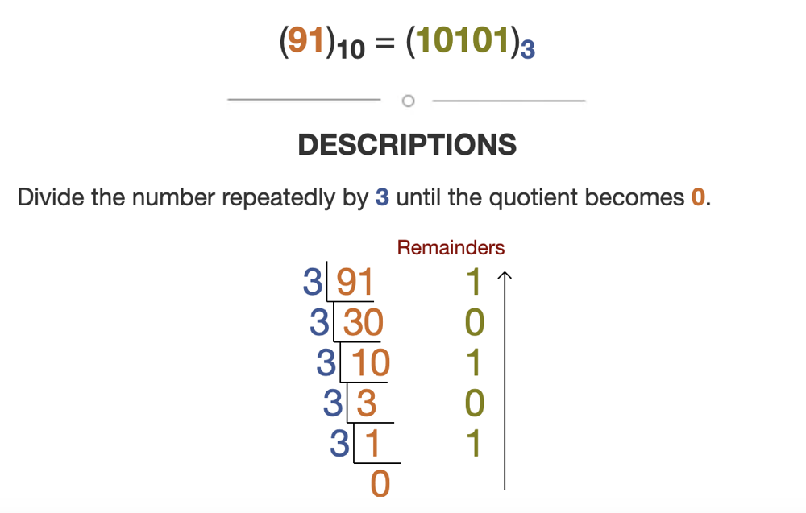
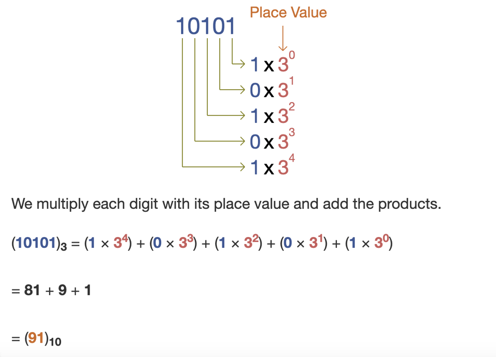

# Easy solution with graphic explanation, single loop, no inbuilt function

**Author:** v1dhn
**Votes:** 9
**Link:** [https://leetcode.com/problems/check-if-number-is-a-sum-of-powers-of-three/solutions/4668996/](https://leetcode.com/problems/check-if-number-is-a-sum-of-powers-of-three/solutions/4668996/)

---

# Intuition
<!-- Describe your first thoughts on how to solve this problem. -->
Let us take the example of 91 : 



Now to get back 91 from 10101 :




# Approach
<!-- Describe your approach to solving the problem. -->
It is evident that if a number is sum of DISTINCT power of 3, dividing repeatedly by 3, will always leave remainder 0 or 1 only.

Note that, if "distinct" power is not mentioned, answer will be true for every input. Since, 3^0 = 1 \uD83D\uDE02

# Complexity
- Time complexity: O(logn)
<!-- Add your time complexity here, e.g. $$O(n)$$ -->
The while loop iterates at most log base 3 of n times. In each iteration, the value of n is divided by 3, so it takes at most log base 3 of n iterations for n to reach 0.

- Space complexity: O(1)
<!-- Add your space complexity here, e.g. $$O(n)$$ -->

# Code
```
class Solution:
    def checkPowersOfThree(self, n: int) -> bool:
        while n!=0:
            rem = n%3
            if rem==2:
                return False
            n = n//3
        return True
        
```