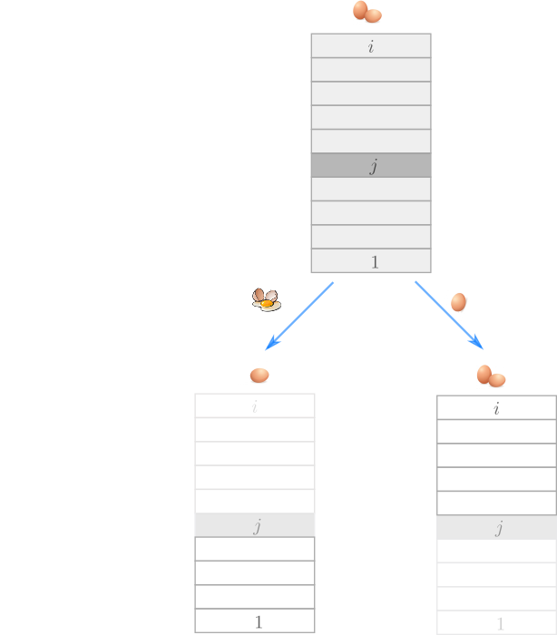
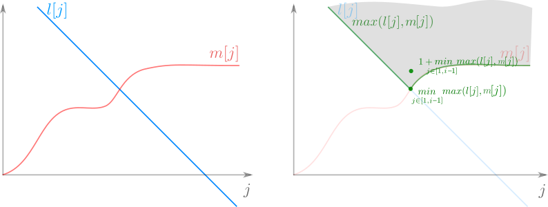
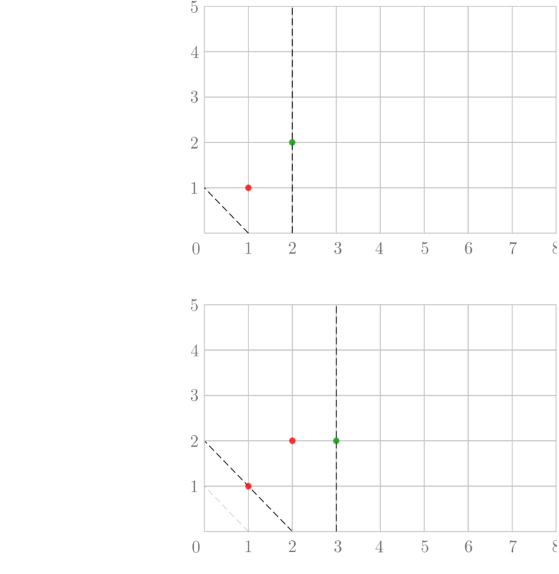
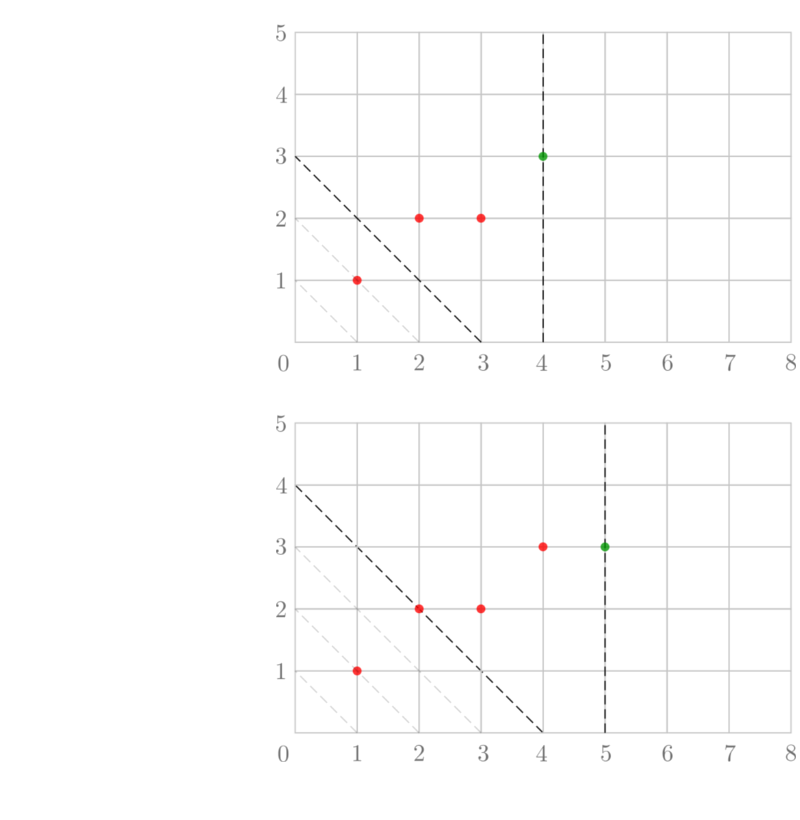
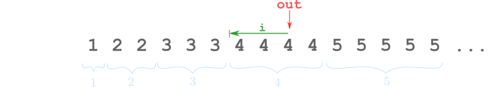
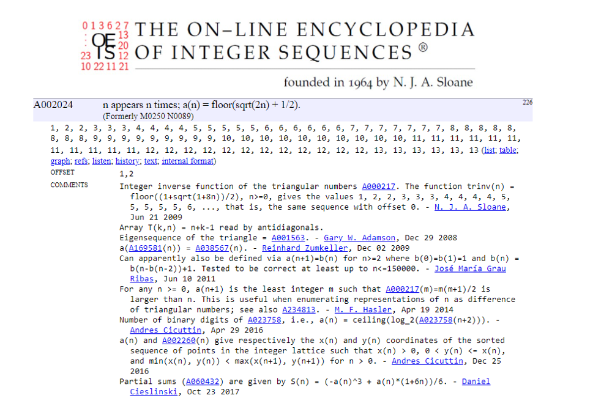

# 🚩 3+ solutions ^^

**Author:** andrii_khlevniuk
**Votes:** 55
**Link:** [https://leetcode.com/problems/egg-drop-with-2-eggs-and-n-floors/solutions/1251343/](https://leetcode.com/problems/egg-drop-with-2-eggs-and-n-floors/solutions/1251343/)

---

## Solution 1
**Dynamic programming**
**time `O(N^2)`; space `O(N)`**

Consider dropping the first egg from the `1st`, `2nd`, `3rd` ... `ith` floor. Say we drop an egg from the `j`-th floor. It either breaks or doesn't.
* if it breaks then you know that the "breaking floor" must be below (or equal to `j`). So you have to use the only "egg life" left to test `j-1` floors below (with indices `1...j-1`)
* if it doesn't break, then the "breaking floor" must be above (or there could be no "breaking floor" at all). Fortunately you still have two eggs, thus you can solve the same problem but for `i-j` floors (indices `j+1...i`). Thus to solve problem for `i` we need to know solutions for the same problem for `1,2,3,..,i-1`. That's dynamic programming, baby...




For each `j` consider both "egg breaks" and "egg survives" alternatives, calculate `max` of them and add `1` (as you have used one of the throws already).
You should take minimum of the values calculated for all possible `j \u2208 [1, i]`.
If you store solutions in the vector and start from `1` and proceed for larger `n` then you'll get the following solution.

```
int twoEggDrop(int n)
{
	vector m{0};
	for(auto i{1}; i<=n; ++i) 
	{
		int out{INT_MAX};
		for(auto j{1}; j<=i; ++j)              
			out = min(out, 1+max(m[i-j], j-1));
		m.push_back(out);
	}
	return m.back();    
}
```
If you change variables `j=i-j` you can get arguably simpler formula
```
int twoEggDrop(int n)
{
	vector m{0};
	for(auto i{1}; i<=n; ++i) 
	{
		int out{INT_MAX};
		for(auto j{0}; j<i; ++j)              
			out = min(out, 1+max(m[j], i-j-1));  
		m.push_back(out);
	}
	return m.back();    
}
```
This reminds me algorithm for Catalan's numbers generation in [96. Unique Binary Search Trees](https://leetcode.com/problems/unique-binary-search-trees/discuss/1190656/solutions-and-pictures) (or in [22. Generate Parentheses](https://leetcode.com/problems/generate-parentheses/)).

<details>
<summary>
Here's is the recursive up-bottom variation.
</summary>

**Dynamic programming, bottom up recursion with memoization**
**time `O(N^2)`; space `O(N)`**
```
int twoEggDrop(int n)
{
    static unordered_map<int, int> m{{0,0}};
    if(m.count(n)) return m[n];
  	int out{INT_MAX};
    for(auto j{0}; j<n; ++j)              
	    out = min(out, 1+max(twoEggDrop(j), n-j-1));
	return m[n]=out;    
}
```
</details>

**Analysis**

Let's talk about this part of the solution 
```
	int out{INT_MAX};
	for(auto j{0}; j<i; ++j)              
		out = min(out, 1+max(m[j], i-j-1));
	m.push_back(out);
```
To calculate `m[i]` it considers a line `l(j)=i-j-1` and a function `m[j]` in the range `j \u2208 [1, i-1]`.
It takes `max(l(j), m(j))`, finds it's minimum by linear search, adds `1` to it and assigns it to `m[i]`.

It's like this
<br>



<br>
only for discrete case.

If you draw some more pictures (\uD83D\uDE42) you can come up with the "graphical algo":
* to calculate `m[i]` draw line with slope `-1` that crosses `x` axis at point `i-1`.
* if it passes through one of the red points then `m[i]=m[i-1]`. If it doesn't then `m[i]=m[i-1]+1`

<br>





<br>

Pictures help to realize that the `m[i]` is very tightly connected to `m[i-1]`: it's either `m[i-1]` or `m[i-1]+1`. Moreover the function is **highly regular and predictable**: `1,2,2,3,3,3,4,4,4,4...`.

## Solution 2

**time `O(N)`; space `O(1)`**

So as we have seen we just want to replicate the following sequence
<br>


One `1`, two `2`s, three `3`s and so on.
You can generate it with the help of linear algorithm (you'll need two extra variables: a counter `i` and a current output variable `out`)
<br>


like this 
```
int twoEggDrop(int n)
{
	int out{};
	for(int i{}; n--; ++i>out ? out=i, i=1 : 0);           
	return out;    
}
```
or maybe like this
```
int twoEggDrop(int n)
{
	int out{};
	for(int i{}; n; --n)
		if(++i>out) out=i, i=1;
	return out;    
}
```
## Solution 3

**time `O(1)`; space `O(1)`**

Using some math magic you can come up with the formula to solve the problem in `O(1)`.
The key is to derive integer inverse function of the triangular numbers **trinv(n)** and to shift it by `1`.
<br>


```
int twoEggDrop(int n)
{
	return (1+sqrt(8.0*n-7))/2;    
}
```
also you can use this formula
```
int twoEggDrop(int n)
{
	return floor(sqrt(2.0*n) + 0.5);    
}
```
**What is this sequence ?**

I've looked this sequence up, and [that's](https://oeis.org/A002024) what I've found.



