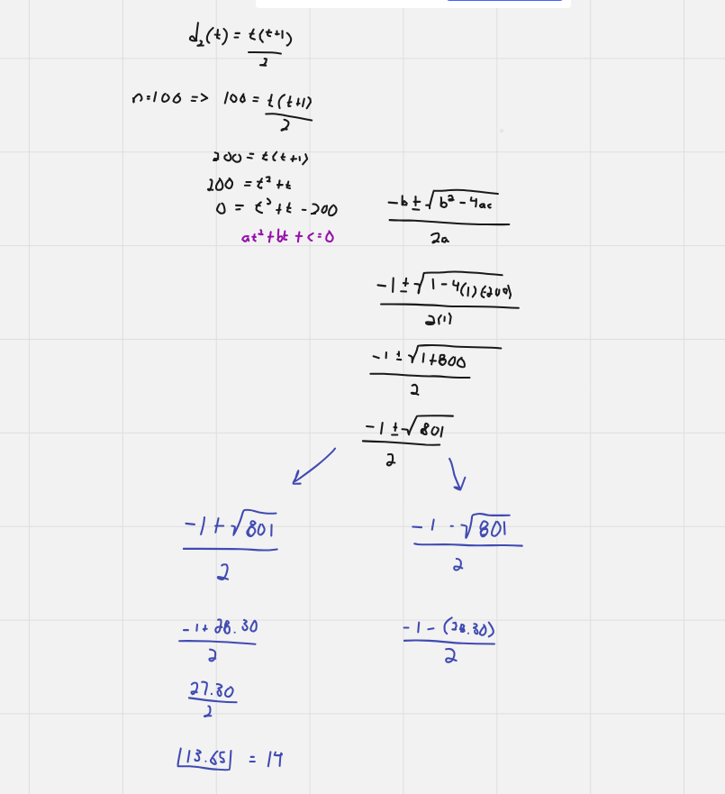

# Dart Solution

**Author:** Friendlygecko
**Votes:** 0
**Link:** [https://leetcode.com/problems/egg-drop-with-2-eggs-and-n-floors/solutions/4176777/](https://leetcode.com/problems/egg-drop-with-2-eggs-and-n-floors/solutions/4176777/)

---

# Intuition
<!-- Describe your first thoughts on how to solve this problem. -->
Read this first: [egg-problem](https://spencermortensen.com/articles/egg-problem/)
We can use the Quadratic formula to get the answer. The only difference is that we round up the answer to the nearest whole number. Since the quadratic formula allows us to add or subtract the discriminant, we must add since that would give us a positive answer.

# Approach
<!-- Describe your approach to solving the problem. -->

# Complexity
- Time complexity:
<!-- Add your time complexity here, e.g. $$O(n)$$ -->

- Space complexity:
<!-- Add your space complexity here, e.g. $$O(n)$$ -->

# Code
```
class Solution {
  int twoEggDrop(int n) {
      final nDouble = n * 2;
      final discriminant = (pow(1, 2).toInt() - (4 * 1 * (-nDouble)));
      final ans = (-1 + sqrt(discriminant)) / 2;
      return ans.ceil();
  }
}
```

