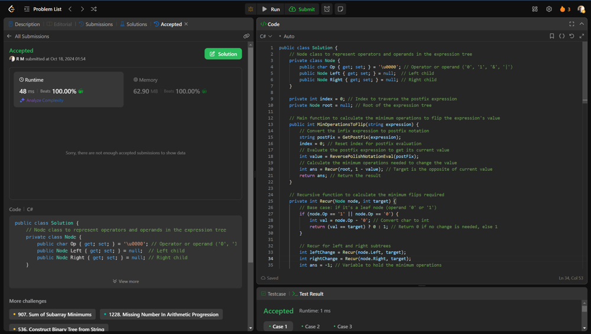

# 💥💥Beats 100% on runtime and memory [EXPLAINED]

**Author:** r9n
**Votes:** 0
**Link:** [https://leetcode.com/problems/minimum-cost-to-change-the-final-value-of-expression/solutions/5929989/](https://leetcode.com/problems/minimum-cost-to-change-the-final-value-of-expression/solutions/5929989/)

---




# Intuition
Transform a given boolean expression into its opposite value by counting the minimum number of changes needed. Each change can be flipping a 1 to 0, a 0 to 1, or changing operators between & and |.

# Approach
Convert the expression to postfix notation, build an expression tree, then recursively evaluate the tree to calculate the minimum operations required to achieve the desired target value (0 or 1).

# Complexity
- Time complexity:
 O(n), where n is the length of the expression, due to the linear pass needed for both converting to postfix and evaluating the expression tree.

- Space complexity:
O(n) for storing the expression tree and the stack used during evaluation, where n is again the length of the expression.

# Code
```csharp []
public class Solution {
    // Node class to represent operators and operands in the expression tree
    private class Node {
        public char Op { get; set; } = '\\u0000'; // Operator or operand ('0', '1', '&', '|')
        public Node Left { get; set; } = null;  // Left child
        public Node Right { get; set; } = null; // Right child
    }

    private int index = 0; // Index to traverse the postfix expression
    private Node root = null; // Root of the expression tree

    // Main function to calculate the minimum operations to flip the expression's value
    public int MinOperationsToFlip(string expression) {
        // Convert the infix expression to postfix notation
        string postFix = GetPostFix(expression);
        index = 0; // Reset index for postfix evaluation
        // Evaluate the postfix expression to get its current value
        int value = ReversePolishNotationEval(postFix);
        // Calculate the minimum operations needed to change the value
        int ans = Recur(root, 1 - value); // Target is the opposite of current value
        return ans; // Return the result
    }

    // Recursive function to calculate the minimum flips required
    private int Recur(Node node, int target) {
        // Base case: if it's a leaf node (operand '0' or '1')
        if (node.Op == '1' || node.Op == '0') {
            int val = node.Op - '0'; // Convert char to int
            return (val == target) ? 0 : 1; // Return 0 if no change is needed, else 1
        }

        // Recur for left and right subtrees
        int leftChange = Recur(node.Left, target);
        int rightChange = Recur(node.Right, target);
        int ans = -1; // Variable to hold the minimum operations

        // Logic for flipping operations based on target value
        if (target == 0) {
            // If we want to change to 0
            if (node.Op == '|') {
                // For OR operation, at least one side must be flipped to AND
                ans = Math.Min(1 + Math.Min(leftChange, rightChange), leftChange + rightChange);
            } else {
                // For AND operation, we need both sides to be flipped
                ans = Math.Min(leftChange + rightChange + 1, Math.Min(leftChange, rightChange));
            }
        } else {
            // If we want to change to 1
            if (node.Op == '|') {
                // For OR operation, at least one side should remain true
                ans = Math.Min(Math.Min(leftChange, rightChange), leftChange + rightChange + 1);
            } else {
                // For AND operation, at least one side must be flipped to true
                ans = Math.Min(1 + Math.Min(leftChange, rightChange), leftChange + rightChange);
            }
        }

        return ans; // Return the calculated minimum operations
    }

    // Evaluate the postfix expression using a stack and build the expression tree
    private int ReversePolishNotationEval(string postFix) {
        var stack = new Stack<int>(); // Stack to hold integer values
        var nodeStack = new Stack<Node>(); // Stack to hold tree nodes

        while (index < postFix.Length) {
            char ch = postFix[index++]; // Get current character from postfix expression
            Node node = new Node(); // Create a new node

            if (ch == '0' || ch == '1') {
                // If the character is an operand, push it to the stack
                stack.Push(ch - '0');
                node.Op = ch; // Set the operand in the node
                nodeStack.Push(node); // Push the node to the node stack
            } else {
                // Otherwise, it's an operator
                int val1 = stack.Pop(); // Get the top two values from the stack
                int val2 = stack.Pop();
                node.Op = ch; // Set the operator in the node
                node.Right = nodeStack.Pop(); // Set right child
                node.Left = nodeStack.Pop(); // Set left child
                nodeStack.Push(node); // Push the node back to the node stack
                int temp = (ch == '&') ? (val1 & val2) : (val1 | val2); // Calculate the value
                stack.Push(temp); // Push the result back to the stack
            }
        }
        root = nodeStack.Pop(); // Get the root of the expression tree
        return stack.Pop(); // Return the final evaluated value
    }

    // Convert infix expression to postfix using the Shunting Yard algorithm
    private string GetPostFix(string exp) {
        var res = new StringBuilder(); // StringBuilder to build the postfix expression
        var stack = new Stack<char>(); // Stack to hold operators

        foreach (char c in exp) {
            if (c == '0' || c == '1') {
                // If the character is an operand, append to the result
                res.Append(c);
            } else if (c == '(') {
                stack.Push(c); // Push '(' to the stack
            } else if (c == ')') {
                // Pop from the stack until '(' is found
                while (stack.Count > 0 && stack.Peek() != '(') {
                    res.Append(stack.Pop());
                }
                stack.Pop(); // Remove the '(' from the stack
            } else {
                // Handle operators
                while (stack.Count > 0 && stack.Peek() != '(') {
                    res.Append(stack.Pop()); // Pop all operators to the result
                }
                stack.Push(c); // Push the current operator to the stack
            }
        }
        // Pop remaining operators from the stack
        while (stack.Count > 0) {
            res.Append(stack.Pop());
        }

        return res.ToString(); // Return the constructed postfix expression
    }
}


```