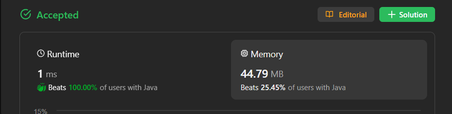

# ✅ Beats 100% - C++/Java/Python/JS - Odd Number Substring - Visualized

**Author:** lancertech6
**Votes:** 136
**Link:** [https://leetcode.com/problems/largest-odd-number-in-string/solutions/4372468/](https://leetcode.com/problems/largest-odd-number-in-string/solutions/4372468/)

---



# YouTube Video Explanation:

[https://youtu.be/_own7BywSmk](https://youtu.be/_own7BywSmk)
<!-- **If you want a video for this question please write in the comments** -->

**\uD83D\uDD25 Please like, share, and subscribe to support our channel's mission of making complex concepts easy to understand.**

Subscribe Link: https://www.youtube.com/@leetlogics/?sub_confirmation=1

*Subscribe Goal: 700 Subscribers*
*Current Subscribers: 630*

---

# Example Explanation
Let's create a step-by-step explanation using a table:

| Iteration | Current Substring | Last Digit | Odd? | Action                             |
|-----------|---------------------|-------------|------|------------------------------------|
| 1         | "52"                | 2           | No   | Move left (decrement index)       |
| 2         | "5"                 | 5           | Yes  | Return the substring "5"          |

Explanation:
1. Start with the given string "52".
2. The last digit is 2, which is not odd, so move left.
3. Move left to "5", which is an odd digit. Return the substring "5".

This way, we find the largest odd number ("5") within the given string "52".

---
# Intuition
<!-- Describe your first thoughts on how to solve this problem. -->
The goal is to find the largest odd number within a given integer represented as a string. We need to identify the largest odd substring or return an empty string if no odd number exists.

# Approach
<!-- Describe your approach to solving the problem. -->
1. Iterate through the string from right to left.
2. If the last digit is odd, return the entire string as it is already the largest odd number.
3. If the last digit is even, keep moving left until an odd digit is found.
4. Return the substring from the beginning of the string to the index where the first odd digit is encountered.

# Complexity
- The time complexity is O(n), where n is the length of the input string num.
- The space complexity is O(1) since we are not using any extra space that scales with the input size.

# Code
```java []
class Solution {
    public String largestOddNumber(String num) {
        if((int)num.charAt(num.length()-1)%2==1) return num;
        int i=num.length()-1;
        while(i>=0){
            int n=num.charAt(i);
            if(n%2==1) return num.substring(0,i+1);
            i--;
        }
        return "";
    }
}
```
```C++ []
class Solution {
public:
    string largestOddNumber(string num) {
        if (num.back() % 2 == 1) return num;
        int i = num.length() - 1;
        while (i >= 0) {
            int n = num[i];
            if (n % 2 == 1) return num.substr(0, i + 1);
            i--;
        }
        return "";
    }
};
```
```Python []
class Solution(object):
    def largestOddNumber(self, num):
        for i in range(len(num) - 1, -1, -1):
            if num[i] in {'1', '3', '5', '7', '9'}:
                return num[:i + 1]
        return ''
        
```
```Javascript []
/**
 * @param {string} num
 * @return {string}
 */
var largestOddNumber = function(num) {
    if (parseInt(num.slice(-1)) % 2 === 1) return num;
    let i = num.length - 1;
    while (i >= 0) {
        const n = parseInt(num[i]);
        if (n % 2 === 1) return num.slice(0, i + 1);
        i--;
    }
    return "";
};
```

