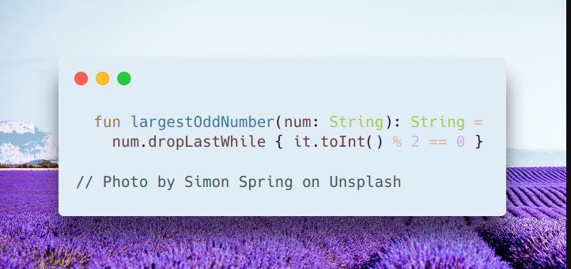

# Kotlin | one-liner

**Author:** SamoylenkoDmitry
**Votes:** 4
**Link:** [https://leetcode.com/problems/largest-odd-number-in-string/solutions/4374041/](https://leetcode.com/problems/largest-odd-number-in-string/solutions/4374041/)

---




#### Join me on Telegram

https://t.me/leetcode_daily_unstoppable/431

#### Intuition

Just search for the last odd

#### Approach

Let's writt Kotlin one-liner

#### Complexity

- Time complexity:
$$O(n)$$

- Space complexity:
$$O(n)$$

#### Code

```kotlin

  fun largestOddNumber(num: String): String =
    num.dropLastWhile { it.toInt() % 2 == 0 }

```