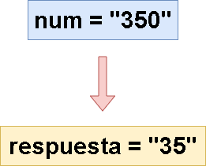

# 🔥🔥 Explicación y Resolución Del Ejercicio En Español Java | Python | PHP | JavaScript | C++🔥🔥

**Author:** hermescoder02
**Votes:** 5
**Link:** [https://leetcode.com/problems/largest-odd-number-in-string/solutions/4919919/](https://leetcode.com/problems/largest-odd-number-in-string/solutions/4919919/)

---

# Lectura
*N\xFAmero impar m\xE1s grande en una palabra (Java, Python, PHP, Javascript, C++)*

Dado un string que representa un n\xFAmero entero, se debe devolver el mayor n\xFAmero impar (como una cadena). En caso contrario, se devolver\xE1 un espacio vac\xEDo (\u201C\u201D).



# Video

https://youtu.be/w7UNqSl__sk?si=-s48sUqLKNdlY4nJ


Si te gust\xF3 el contenido \xA1te invito a suscribirte!: 
\u2705https://www.youtube.com/@hermescoder?sub_confirmation=1

# Pasos para realizar el algoritmo:

**1.-** Se declara la variable **tama\xF1o**, y en esta se guarda el total de caracteres del string num - 1, ya que los strings se recorren desde la posici\xF3n 0.

**2.-** Se recorre el string desde el final hasta el inicio utilizando i como \xEDndice.

**3.-** Se extrae el car\xE1cter evaluado y se verifica si es impar. Si es as\xED, se retorna un substring que va desde las posici\xF3n 0 hasta la actual(i) + 1, lo que significa que devuelve el n\xFAmero impar m\xE1s grande encontrado hasta ese momento.

**4.-** Si el ciclo termina sin encontrar un d\xEDgito impar, la funci\xF3n retorna vac\xEDo 

# C\xF3digo 

```Java []
public class Solution {
    public static String largestOddNumber(String num) {
        //paso#1
        int tamano = num.length() - 1;
        
        //paso#2
        for (int i = tamano; i >= 0; i--) {
            //paso#3
            int letra = (int)num.charAt(i);
            if (letra % 2 != 0) return num.substring(0, i + 1);
        }

        //paso#4
        return "";
    }
}
```

```PHP []
class Solution {
    function largestOddNumber($num) {
        // Paso #1
        $tamano = strlen($num) - 1;

        // Paso #2
        for ($i = $tamano; $i >= 0; $i--) {
            // Paso #3
            $letra = ord($num[$i]);

            // Paso #4
            if ($letra % 2 != 0) {
                return substr($num, 0, $i + 1);
            }
        }

        // Paso #5
        return "";
    }
}
```

```Python []
class Solution(object):
    def largestOddNumber(self, num):
        # Paso #1
        tamano = len(num) - 1

        # Paso #2
        for i in range(tamano, -1, -1):
            # Paso #3
            letra = ord(num[i])
            if letra % 2 != 0:
                return num[:i + 1]

        # Paso #4
        return ""
```
```JavaScript []
var largestOddNumber = function(num) {
    // Paso #1
    const tamano = num.length - 1;

    // Paso #2
    for (let i = tamano; i >= 0; i--) {
        // Paso #3
        const letra = num.charCodeAt(i);
        if (letra % 2 !== 0) {
            return num.substring(0, i + 1);
        }
    }

    // Paso #4
    return "";
};
```
```C++ []
#include <string>


class Solution {
public:
    string largestOddNumber(string num) {
        // Paso #1
        int tamano = num.length() - 1;

        // Paso #2
        for (int i = tamano; i >= 0; i--) {
            // Paso #3
            int letra = (int)num.at(i);
            if (letra % 2 != 0) return num.substr(0, i + 1);
        }

        // Paso #4
        return "";
    }
};
```


# Imagenes de la Explicaci\xF3n 
 


# Mas ejercicios de leetcode en espa\xF1ol \uD83D\uDE42

- [Integer To Roman (Entero a romano)
](https://leetcode.com/problems/integer-to-roman/solutions/4872642/explicacion-y-resolucion-del-ejercicio-en-espanol-java-python-php-javascript-c/)

- [Median of two sorted arrays (Mediana de dos arrays ordenadas)
](https://leetcode.com/problems/median-of-two-sorted-arrays/solutions/4843610/explicacion-y-resolucion-del-ejercicio-en-espanol-java-python-php-javascript-c/)


- [Container with most water (Recipiente con m\xE1s agua)
](https://leetcode.com/problems/container-with-most-water/solutions/4797655/explicacion-y-resolucion-del-ejercicio-en-espanol-java-python-php-javascript-c/)

- [Linked list cycle II (Ciclo de una lista enlazada II)
](https://leetcode.com/problems/linked-list-cycle-ii/solutions/4757653/explicacion-y-resolucion-del-ejercicio-en-espanol-java-python-php-javascript-c/)

- [Sort Colors (Ordenar colores)](https://leetcode.com/problems/sort-colors/solutions/4693109/explicacion-y-resolucion-del-ejercicio-en-espanol-java-python-php-javascript-c/)
