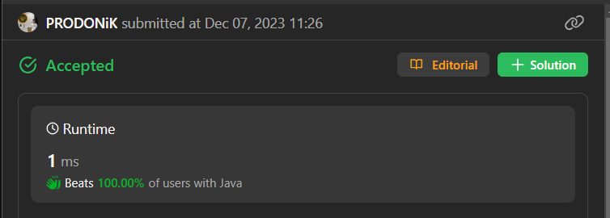

# 🚀🚀🚀BEATS 100% CODERS (EASY PEASY Java, C++, C#, Python, Ruby)✅🚀🚀🚀by PRODONiK

**Author:** prodonik
**Votes:** 4
**Link:** [https://leetcode.com/problems/largest-odd-number-in-string/solutions/4373407/](https://leetcode.com/problems/largest-odd-number-in-string/solutions/4373407/)

---


# Intuition
The problem appears to involve finding the largest odd number by examining the digits of a given number `num`. The intuition might involve iterating through the digits from right to left and identifying the first odd digit.

# Approach
The code initializes an index variable to the last digit of the number (`num.length() - 1`) and iterates through the digits from right to left using a `while` loop. In each iteration, it checks if the digit at the current index is even. If the digit is even, it decrements the index, continuing the search for the rightmost odd digit.

Once the rightmost odd digit is found, the code returns the substring of the original number from the beginning to the index (inclusive), effectively removing all the trailing even digits.

# Complexity
- Time complexity: O(n)
  The time complexity is linear, where `n` is the length of the input number `num`. The algorithm iterates through the digits of the number to find the rightmost odd digit.

- Space complexity: O(1)
  The space complexity is constant, as the algorithm uses only a constant amount of additional space for variables (`index`).

# Code
```java []
class Solution {
    public String largestOddNumber(String num) {
        int index = num.length() - 1;
        while (index > -1 && (num.charAt(index) - '0') % 2 == 0) {
            index--;
        }
        return num.substring(0, index + 1);
    }
}
```
```C++ []
class Solution {
public:
    std::string largestOddNumber(std::string num) {
        int index = num.length() - 1;
        while (index > -1 && (num[index] - '0') % 2 == 0) {
            index--;
        }
        return num.substr(0, index + 1);
    }
};
```
```C# []
public class Solution {
    public string LargestOddNumber(string num) {
        int index = num.Length - 1;
        while (index > -1 && (num[index] - '0') % 2 == 0) {
            index--;
        }
        return num.Substring(0, index + 1);
    }
}
```
```Python []
class Solution:
    def largestOddNumber(self, num: str) -> str:
        index = len(num) - 1
        while index > -1 and int(num[index]) % 2 == 0:
            index -= 1
        return num[:index + 1]
```
```Ruby []
class Solution
  def largest_odd_number(num)
    index = num.length - 1
    while index > -1 && num[index].to_i % 2 == 0
      index -= 1
    end
    num[0..index]
  end
end
