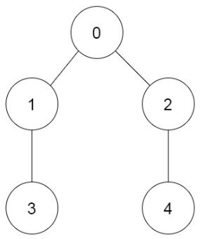

# [1916. Count Ways to Build Rooms in an Ant Colony](https://leetcode.com/problems/count-ways-to-build-rooms-in-an-ant-colony/)

| Category | Difficulty | Likes | Dislikes |
| :------: | :--------: | :---: | :------: |
| Algorithms | Hard | 521 | 56 |

**Tags:** [`math`](https://leetcode.com/tag/math), [`dynamic-programming`](https://leetcode.com/tag/dynamic-programming), [`tree`](https://leetcode.com/tag/tree), [`graph`](https://leetcode.com/tag/graph), [`topological-sort`](https://leetcode.com/tag/topological-sort), [`combinatorics`](https://leetcode.com/tag/combinatorics)

**Companies:** `adobe`

## Description

You are an ant tasked with adding `n` new rooms numbered `0` to `n-1` to your colony. You are given the expansion plan as a **0-indexed** integer array of length `n`, `prevRoom`, where `prevRoom[i]` indicates that you must build room `prevRoom[i]` before building room `i`, and these two rooms must be connected **directly**. Room `0` is already built, so `prevRoom[0] = -1`. The expansion plan is given such that once all the rooms are built, every room will be reachable from room `0`.


You can only build **one room** at a time, and you can travel freely between rooms you have **already built** only if they are **connected**. You can choose to build **any room** as long as its **previous room** is already built.


Return *the **number of different orders** you can build all the rooms in*. Since the answer may be large, return it **modulo** `10^9 + 7`.


 


**Example 1:**


```

Input: prevRoom = [-1,0,1]
Output: 1
Explanation:&nbsp;There is only one way to build the additional rooms: 0 &rarr; 1 &rarr; 2

```


**Example 2:**

****

```

Input: prevRoom = [-1,0,0,1,2]
Output: 6
Explanation:
The 6 ways are:
0 &rarr; 1 &rarr; 3 &rarr; 2 &rarr; 4
0 &rarr; 2 &rarr; 4 &rarr; 1 &rarr; 3
0 &rarr; 1 &rarr; 2 &rarr; 3 &rarr; 4
0 &rarr; 1 &rarr; 2 &rarr; 4 &rarr; 3
0 &rarr; 2 &rarr; 1 &rarr; 3 &rarr; 4
0 &rarr; 2 &rarr; 1 &rarr; 4 &rarr; 3

```


 


**Constraints:**


	- `n == prevRoom.length`

	- `2 <= n <= 10^5`

	- `prevRoom[0] == -1`

	- `0 <= prevRoom[i] < n` for all `1 <= i < n`

	- Every room is reachable from room `0` once all the rooms are built.

---

**Links:** [Submissions](https://leetcode.com/problems/count-ways-to-build-rooms-in-an-ant-colony/) | [Solutions](https://leetcode.com/problems/count-ways-to-build-rooms-in-an-ant-colony/)
