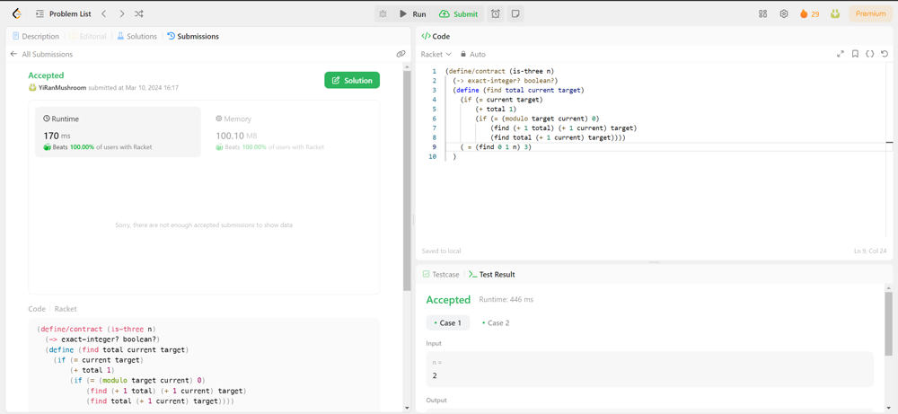

# Racket (beat 100%)

**Author:** YiRanMushroom
**Votes:** 0
**Link:** [https://leetcode.com/problems/three-divisors/solutions/4856283/](https://leetcode.com/problems/three-divisors/solutions/4856283/)

---

I hate racket, but I need to pass the exam. So, yeah, I will try to use this kind of questions to exercise.




# Code
```
(define/contract (is-three n)
  (-> exact-integer? boolean?)
  (define (find total current target)
    (if (= current target)
        (+ total 1)
        (if (= (modulo target current) 0)
            (find (+ 1 total) (+ 1 current) target)
            (find total (+ 1 current) target))))
    ( = (find 0 1 n) 3)
  )
```