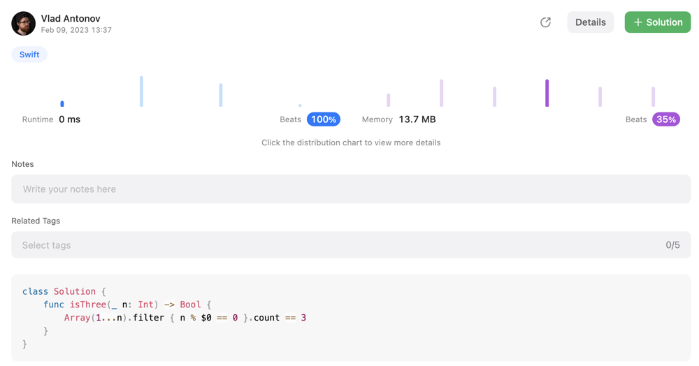

# One line solution on Swift. Beats 100%

**Author:** blackbirdNG
**Votes:** 1
**Link:** [https://leetcode.com/problems/three-divisors/solutions/3164194/](https://leetcode.com/problems/three-divisors/solutions/3164194/)

---

### Please upvote if my solution was helpful to you!
```
class Solution {
    func isThree(_ n: Int) -> Bool {
        Array(1...n).filter { n % $0 == 0 }.count == 3
    }
}
```

