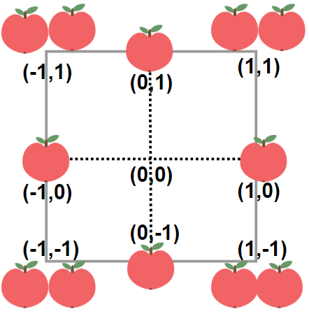

# [1954. Minimum Garden Perimeter to Collect Enough Apples](https://leetcode.com/problems/minimum-garden-perimeter-to-collect-enough-apples/)

| Category | Difficulty | Likes | Dislikes |
| :------: | :--------: | :---: | :------: |
| Algorithms | Medium | 403 | 98 |

**Tags:** [`math`](https://leetcode.com/tag/math), [`binary-search`](https://leetcode.com/tag/binary-search)

**Companies:** `amazon`

## Description

In a garden represented as an infinite 2D grid, there is an apple tree planted at **every** integer coordinate. The apple tree planted at an integer coordinate `(i, j)` has `|i| + |j|` apples growing on it.

You will buy an axis-aligned **square plot** of land that is centered at `(0, 0)`.

Given an integer `neededApples`, return *the **minimum perimeter** of a plot such that **at least***** **`neededApples` *apples are **inside or on** the perimeter of that plot*.

The value of `|x|` is defined as:

	- `x` if `x >= 0`

	- `-x` if `x < 0`

 

**Example 1:**


```

Input: neededApples = 1
Output: 8
Explanation: A square plot of side length 1 does not contain any apples.
However, a square plot of side length 2 has 12 apples inside (as depicted in the image above).
The perimeter is 2 * 4 = 8.

```

**Example 2:**

```

Input: neededApples = 13
Output: 16

```

**Example 3:**

```

Input: neededApples = 1000000000
Output: 5040

```

 

**Constraints:**

	- `1 <= neededApples <= 10^15`

---

**Links:** [Submissions](https://leetcode.com/problems/minimum-garden-perimeter-to-collect-enough-apples/) | [Solutions](https://leetcode.com/problems/minimum-garden-perimeter-to-collect-enough-apples/)
