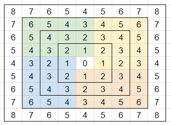

# Brute force with picture

**Author:** votrubac
**Votes:** 33
**Link:** [https://leetcode.com/problems/minimum-garden-perimeter-to-collect-enough-apples/solutions/1375507/](https://leetcode.com/problems/minimum-garden-perimeter-to-collect-enough-apples/solutions/1375507/)

---

This problem is also tricky to solve, unless you figure out the formula. You can compute number of apples based on the distance from 0 (`len`). We can add a binary search but it works pretty fast as it is. There is also a O(1) formula.

How can we can figure out the number of apples based on `len`? Let's split the area into 4 similar zones. For one of the highlighted zones, we see [1,2,3], [2,3,4], [3,4,5], [4,5,6].



For a single area, using the sum of arithmetic progression:
[1..n]: `n * (n + 1) / 2`
[2..n +1]: `n * (n + 1) / 2` + `n * 1`
[3..n +2]: `n * (n + 1) / 2` + `n * 2 `
[4..n +3]: `n * (n + 1) / 2` + `n * 3`

So we have `n * (n + 1) / 2`, then we add `n * (n + 1) / 2` times `n`, then we add `n` times `n * n (n + 1) / 2`, which is `[n * (n + 1) / 2] * (1 + n + n)`.

 Since we have 4 areas, the final formula looks like this: `2 * n * (n + 1) * (1 + 2 * n)`.
**Java**
```java
public long minimumPerimeter(long neededApples) {
    long n = 0;
    while (2 * n * (n + 1) * (1 + 2 * n) < neededApples)
        ++n;
    return  n * 8;
}
```
**C++**
```cpp
long long minimumPerimeter(long long neededApples) {
    long long n = 0;
    while (2 * n * (n + 1) * (1 + 2 * n) < neededApples)
        ++n;
    return  n * 8;
}
```