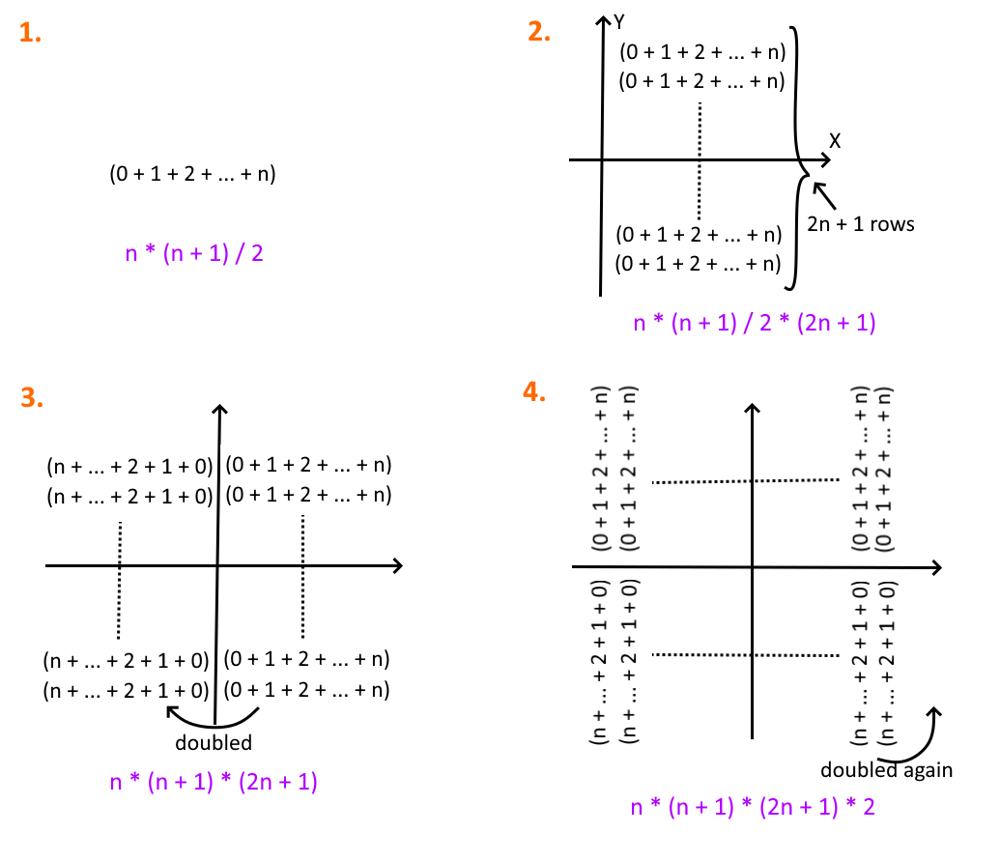

# [Rust / Elixir] binary search

**Author:** Minamikaze392
**Votes:** 0
**Link:** [https://leetcode.com/problems/minimum-garden-perimeter-to-collect-enough-apples/solutions/3361638/](https://leetcode.com/problems/minimum-garden-perimeter-to-collect-enough-apples/solutions/3361638/)

---

# Approach


Formula for total number of apples is `n * (n + 1) * (2 * n + 1) * 2`.

Initial value of `hi` and `lo` are assigned such that:
$hi^3 * 2 \	hickapprox needed\\_apples$
$(2 * lo + 1)^3 * 2 \	hickapprox needed\\_apples$

# Code
```Rust []
impl Solution {
    pub fn minimum_perimeter(needed_apples: i64) -> i64 {
        let mut hi = (needed_apples as f64 / 2.0).powf(1.0/3.0).ceil() as i64;
        let mut lo = (hi - 1) / 2;
        while lo < hi {
            let n = (lo + hi) >> 1;
            let apples = n * (n + 1) * (2 * n + 1) * 2;
            if apples < needed_apples {
                lo = n + 1
            }
            else {
                hi = n;
            }
        }
        lo * 8
    }
}
```
```Elixir []
defmodule Solution do
  @spec minimum_perimeter(needed_apples :: integer) :: integer
  def minimum_perimeter(needed_apples) do
    hi = ceil(:math.pow(needed_apples / 2, 1 / 3))
    lo = div(hi - 1, 2)
    binary_search(lo, hi, needed_apples)
  end

  defp binary_search(lo, lo, _), do: lo * 8
  defp binary_search(lo, hi, needed_apples) do
    n = div(lo + hi, 2)
    apples = n * (n + 1) * (2 * n + 1) * 2
    if apples < needed_apples do
      binary_search(n + 1, hi, needed_apples)
    else
      binary_search(lo, n, needed_apples)
    end
  end
end
```