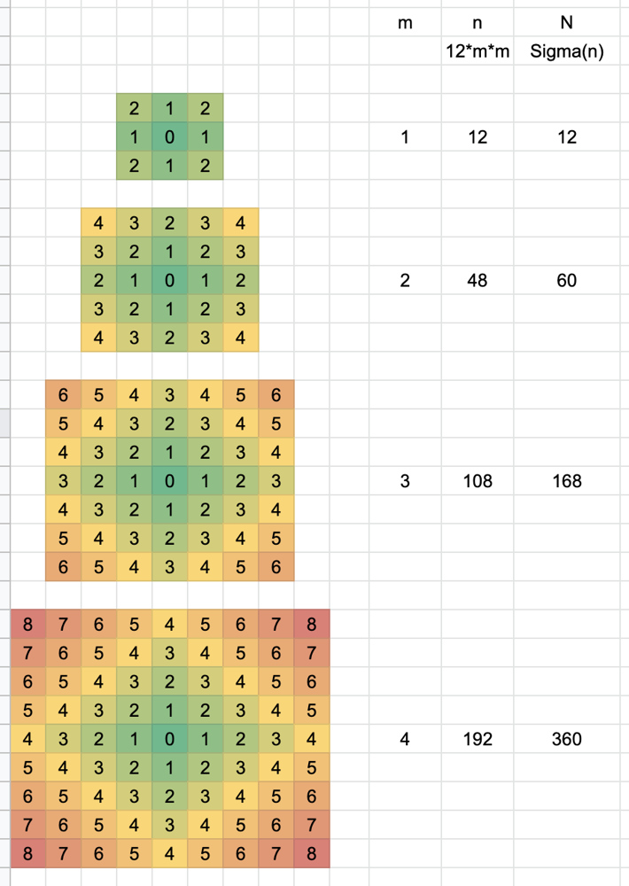

# Binary search, derivation of formula

**Author:** 495
**Votes:** 61
**Link:** [https://leetcode.com/problems/minimum-garden-perimeter-to-collect-enough-apples/solutions/1375791/](https://leetcode.com/problems/minimum-garden-perimeter-to-collect-enough-apples/solutions/1375791/)

---

Let `m` be the level which defines the square plot of land centered at `(0,0)` with perimeter `8*m`
`n` = number of apples on all trees at level `m` (on the perimeter)
`N` = number of apples contained within the square plot of land at level `m`

Following figure illustrates the number of apples at each grid coordinate (represented by a cell)



Let's derive the formula for `n` and `N`

```
    m = 1
    n = 4 * (1+2)
    
    m = 2
    n = 4 * (3+2+3+4)
    
    m = 3
    n = 4 * (5+4+3+4+5+6) 

    m = m
    n = 4 * (m + 2(m+1) + 2(m+2) + 2(m+3) + ... + 2(m+m-1) + m+m)
      = 4 * [(m + 2*m + 2*m + 2*m + ... (m times)) +  2 * (1+2+3+...+(m-1))]
      = 4 * [m + 2*m*m + 2 * m*(m-1)/2]
      = 4 * [m + 2*m*m + m*m - m]
      = 4 * [3*m*m]
      = 12*m*m
      
      
    N(m) = n(1) + n(2) + n(3) + ... + n(m)
         = 12*1 + 12*4 + 12*9 + ... + 12*m*m
         = 12 * (1 + 4 + 9 + ... + m*m)
         = 12 * (m)*(m+1)*(2*m+1)/6
         = 2 * m*(m+1)*(2*m+1)
```

Now, we need to find `m` such that `N(m) >= neededApples`

### Linear search for `m`
```
    def minimumPerimeter(self, neededApples: int) -> int:
        n = m = 0
        while n < neededApples:
            m += 1
            n += 12*m*m
        return 8*m
```		

### Binary search for `m`

```
    def minimumPerimeter(self, neededApples: int) -> int:
        lo, hi = 1, 100000
        while lo < hi:
            m = (lo+hi)//2
            n = 2*m*(m+1)*(2*m+1)
            if n < neededApples: lo = m+1
            else: hi = m
        return 8*lo
```
* note that the `hi = 100000` should be high enough to cover the upper limit of `10^15`