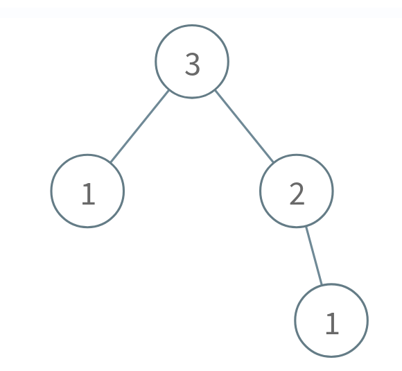
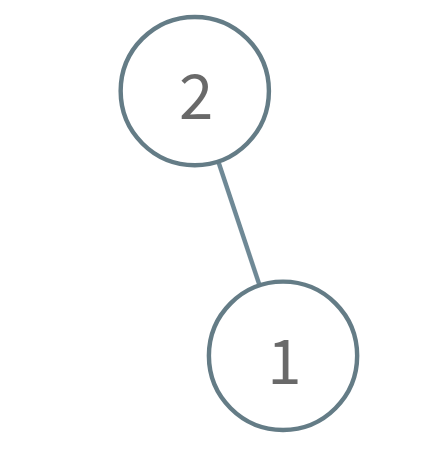

# [2005. Subtree Removal Game with Fibonacci Tree](https://leetcode.com/problems/subtree-removal-game-with-fibonacci-tree/)

| Category | Difficulty | Likes | Dislikes |
| :------: | :--------: | :---: | :------: |
| Algorithms | Hard | 16 | 49 |

**Tags:** [`math`](https://leetcode.com/tag/math), [`dynamic-programming`](https://leetcode.com/tag/dynamic-programming), [`tree`](https://leetcode.com/tag/tree), [`binary-tree`](https://leetcode.com/tag/binary-tree), [`game-theory`](https://leetcode.com/tag/game-theory)

**Companies:** `sony`

## Description

A **Fibonacci** tree is a binary tree created using the order function `order(n)`:

	- `order(0)` is the empty tree.

	- `order(1)` is a binary tree with only **one node**.

	- `order(n)` is a binary tree that consists of a root node with the left subtree as `order(n - 2)` and the right subtree as `order(n - 1)`.

Alice and Bob are playing a game with a **Fibonacci** tree with Alice staring first. On each turn, a player selects a node and removes that node **and** its subtree. The player that is forced to delete `root` loses.

Given the integer `n`, return `true` if Alice wins the game or `false` if Bob wins, assuming both players play optimally.

A subtree of a binary tree `tree` is a tree that consists of a node in `tree` and all of this node's descendants. The tree `tree` could also be considered as a subtree of itself.

 

**Example 1:**



```

Input: n = 3
Output: true
Explanation:
Alice takes the node 1 in the right subtree.
Bob takes either the 1 in the left subtree or the 2 in the right subtree.
Alice takes whichever node Bob doesn&#39;t take.
Bob is forced to take the root node 3, so Bob will lose.
Return true because Alice wins.

```

**Example 2:**


```

Input: n = 1
Output: false
Explanation:
Alice is forced to take the root node 1, so Alice will lose.
Return false because Alice loses.

```

**Example 3:**



```

Input: n = 2
Output: true
Explanation:
Alice takes the node 1.
Bob is forced to take the root node 2, so Bob will lose.
Return true because Alice wins.

```

 

**Constraints:**

	- `1 <= n <= 100`

---

**Links:** [Submissions](https://leetcode.com/problems/subtree-removal-game-with-fibonacci-tree/) | [Solutions](https://leetcode.com/problems/subtree-removal-game-with-fibonacci-tree/)
