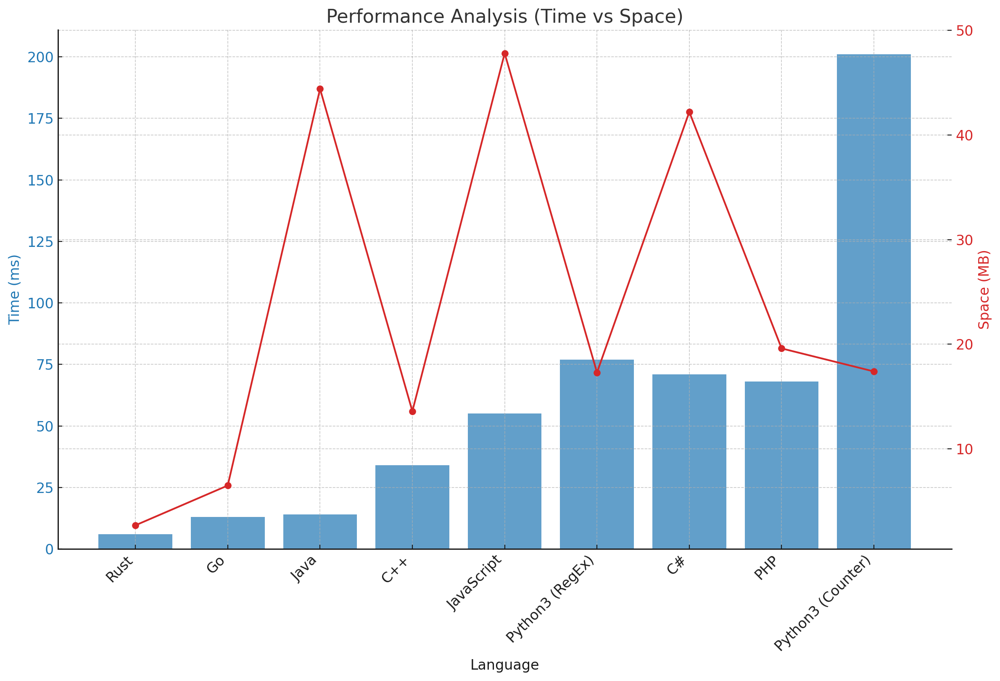

# ✅ 99.81% 2-Approaches RegEx & Iterative Count

**Author:** vanAmsen
**Votes:** 43
**Link:** [https://leetcode.com/problems/remove-colored-pieces-if-both-neighbors-are-the-same-color/solutions/4116737/](https://leetcode.com/problems/remove-colored-pieces-if-both-neighbors-are-the-same-color/solutions/4116737/)

---

# Interview Guide: "Remove Colored Pieces if Both Neighbors are the Same Color" Problem

## Problem Understanding

In the "Remove Colored Pieces if Both Neighbors are the Same Color" problem, you are given a string `colors` where each piece is colored either by 'A' or by 'B'. Alice and Bob play a game where they take alternating turns removing pieces from the line. Alice can only remove a piece colored 'A' if both its neighbors are also colored 'A' and vice versa for Bob with color 'B'. Alice moves first, and if a player cannot make a move on their turn, that player loses. The goal is to determine if Alice can win the game.

## Key Points to Consider

### 1. Understand the Constraints

The length of the string `colors` can be up to $$10^5$$, indicating the need for a solution with a time complexity better than $$O(n^2)$$.

### 2. Multiple Approaches

There are several methods to solve this problem:

  - Regular Expressions (RegEx)
  - Iterative Count
  
Each method has its own nuances, and understanding the logic behind each can provide multiple tools to tackle similar problems.

### 3. Patterns are Key

In this problem, the solution heavily relies on recognizing patterns within the string. Identifying sequences of 'A's and 'B's and understanding how they influence the game's outcome is crucial.

### 4. Explain Your Thought Process

Articulate your reasoning behind each approach and the steps involved. This showcases clarity of thought and can help in discussing the problem's nuances.

## Conclusion

The "Remove Colored Pieces if Both Neighbors are the Same Color" problem is a fascinating blend of string manipulation and game theory. By employing pattern recognition and iterative techniques, one can efficiently determine the game's outcome. Discussing and demonstrating multiple approaches reflects a comprehensive understanding and adaptability to problem-solving.

---

# Live Coding & Explaining 2 Approaches
https://youtu.be/e3qHIM0byhc?si=td8fkcbWHzQ4x39-

# Approach: Iterative Count

The iterative count approach involves traversing the `colors` string and counting consecutive 'A's and 'B's.

## Key Data Structures:
- **Counters**: Utilized to keep track of consecutive occurrences.

## Enhanced Breakdown:

1. **Initialization**:
   - Initialize counters for Alice's and Bob's plays. Start a count for consecutive colors.
   
2. **Iterate through the String**:
   - Traverse the `colors` string. For every character, check if it's the same as the previous one to identify consecutive sequences.
   - When the sequence breaks or changes, calculate plays for Alice or Bob based on the color of the sequence.
   
3. **Handle the Last Segment**:
   - After iterating, handle the last segment of colors and calculate plays for Alice or Bob as needed.
   
4. **Determine the Winner**:
   - Compare the number of plays for both players. If Alice has more plays, she wins.

## Complexity:

**Time Complexity**: 
- The solution requires a single traversal of the `colors` string, leading to a time complexity of $$O(n)$$, where $$n$$ is the length of the string.

**Space Complexity**: 
- We only utilize a few integer counters to keep track of the sequences and plays, so the space complexity is $$O(1)$$.

# Code Iterative Count
``` Python []
class Solution:
    def winnerOfGame(self, colors: str) -> bool:
        alice_plays, bob_plays = 0, 0
        count = 1 
        
        for i in range(1, len(colors)):
            if colors[i] == colors[i - 1]:
                count += 1
            else:
                if colors[i - 1] == 'A':
                    alice_plays += max(0, count - 2)
                else:
                    bob_plays += max(0, count - 2)
                count = 1
        
        if colors[-1] == 'A':
            alice_plays += max(0, count - 2)
        else:
            bob_plays += max(0, count - 2)
        
        return alice_plays > bob_plays
```
``` Rust []
impl Solution {
    pub fn winner_of_game(colors: String) -> bool {
        let mut alice_plays = 0;
        let mut bob_plays = 0;
        let mut count = 0;
        let chars: Vec<char> = colors.chars().collect();
        
        for i in 1..chars.len() {
            if chars[i] == chars[i - 1] {
                count += 1;
            } else {
                if chars[i - 1] == 'A' {
                    alice_plays += (count - 1).max(0);
                } else {
                    bob_plays += (count - 1).max(0);
                }
                count = 0;
            }
        }

        if chars[chars.len() - 1] == 'A' {
            alice_plays += (count - 1).max(0);
        } else {
            bob_plays += (count - 1).max(0);
        }
        
        alice_plays > bob_plays
    }
}
```
``` Go []
package main

func winnerOfGame(colors string) bool {
    alice_plays, bob_plays, count := 0, 0, 0
    
    for i := 1; i < len(colors); i++ {
        if colors[i] == colors[i-1] {
            count++
        } else {
            if colors[i-1] == 'A' {
                alice_plays += max(0, count - 1)
            } else {
                bob_plays += max(0, count - 1)
            }
            count = 0
        }
    }

    if colors[len(colors)-1] == 'A' {
        alice_plays += max(0, count - 1)
    } else {
        bob_plays += max(0, count - 1)
    }
    
    return alice_plays > bob_plays
}

func max(a, b int) int {
    if a > b {
        return a
    }
    return b
}
```
``` C++ []
class Solution {
public:
    bool winnerOfGame(std::string colors) {
        int alice_plays = 0, bob_plays = 0, count = 0;
        
        for (int i = 1; i < colors.size(); i++) {
            if (colors[i] == colors[i - 1]) {
                count++;
            } else {
                if (colors[i - 1] == 'A') {
                    alice_plays += std::max(0, count - 1);
                } else {
                    bob_plays += std::max(0, count - 1);
                }
                count = 0;
            }
        }

        if (colors.back() == 'A') {
            alice_plays += std::max(0, count - 1);
        } else {
            bob_plays += std::max(0, count - 1);
        }
        
        return alice_plays > bob_plays;
    }
};
```
``` Java []
public class Solution {
    public boolean winnerOfGame(String colors) {
        int alice_plays = 0, bob_plays = 0, count = 0;
        
        for (int i = 1; i < colors.length(); i++) {
            if (colors.charAt(i) == colors.charAt(i - 1)) {
                count++;
            } else {
                if (colors.charAt(i - 1) == 'A') {
                    alice_plays += Math.max(0, count - 1);
                } else {
                    bob_plays += Math.max(0, count - 1);
                }
                count = 0;
            }
        }

        if (colors.charAt(colors.length() - 1) == 'A') {
            alice_plays += Math.max(0, count - 1);
        } else {
            bob_plays += Math.max(0, count - 1);
        }
        
        return alice_plays > bob_plays;
    }
}
```
``` PHP []
class Solution {
    function winnerOfGame($colors) {
        $alice_plays = 0; $bob_plays = 0; $count = 0;
        
        for ($i = 1; $i < strlen($colors); $i++) {
            if ($colors[$i] == $colors[$i - 1]) {
                $count++;
            } else {
                if ($colors[$i - 1] == 'A') {
                    $alice_plays += max(0, $count - 1);
                } else {
                    $bob_plays += max(0, $count - 1);
                }
                $count = 0;
            }
        }

        if ($colors[strlen($colors) - 1] == 'A') {
            $alice_plays += max(0, $count - 1);
        } else {
            $bob_plays += max(0, $count - 1);
        }
        
        return $alice_plays > $bob_plays;
    }
}
```
``` JavaScript []
/**
 * @param {string} colors
 * @return {boolean}
 */
var winnerOfGame = function(colors) {
        let alice_plays = 0, bob_plays = 0, count = 0;
        
        for (let i = 1; i < colors.length; i++) {
            if (colors[i] == colors[i - 1]) {
                count++;
            } else {
                if (colors[i - 1] == 'A') {
                    alice_plays += Math.max(0, count - 1);
                } else {
                    bob_plays += Math.max(0, count - 1);
                }
                count = 0;
            }
        }

        if (colors.charAt(colors.length - 1) == 'A') {
            alice_plays += Math.max(0, count - 1);
        } else {
            bob_plays += Math.max(0, count - 1);
        }
        
        return alice_plays > bob_plays;
    }
```
``` C# []
public class Solution {
    public bool WinnerOfGame(string colors) {
        int alice_plays = 0, bob_plays = 0, count = 0;
        
        for (int i = 1; i < colors.Length; i++) {
            if (colors[i] == colors[i - 1]) {
                count++;
            } else {
                if (colors[i - 1] == 'A') {
                    alice_plays += Math.Max(0, count - 1);
                } else {
                    bob_plays += Math.Max(0, count - 1);
                }
                count = 0;
            }
        }

        if (colors[colors.Length - 1] == 'A') {
            alice_plays += Math.Max(0, count - 1);
        } else {
            bob_plays += Math.Max(0, count - 1);
        }
        
        return alice_plays > bob_plays;
    }
}
```

# Approach: RegEx

To solve this problem using RegEx, we search for patterns within the `colors` string that match consecutive 'A's or 'B's of length 3 or more.

## Key Data Structures:
- **Regular Expressions**: Utilized to identify patterns within the string.

## Enhanced Breakdown:

1. **Identify Alice's Plays**:
   - Use regular expressions to find all matches of 'A's of length 3 or more.
   - For each match, calculate how many times Alice can play (length of match - 2) and aggregate them.
  
2. **Identify Bob's Plays**:
   - Similarly, use regular expressions to find all matches of 'B's of length 3 or more.
   - For each match, calculate how many times Bob can play and aggregate them.
   
3. **Determine the Winner**:
   - Compare the number of plays for Alice and Bob. If Alice has more plays, she wins.

## Complexity:

**Time Complexity**: 
- Regular expressions generally operate in $$O(n)$$ time complexity for simple patterns. However, for complex patterns and longer strings, the time complexity can be worse. In our case, since the patterns are straightforward (repeated 'A's or 'B's), the time complexity is roughly $$O(n)$$ for each RegEx search, where $$n$$ is the length of the string. Overall, considering two searches (one for 'A's and one for 'B's), the time complexity remains $$O(n)$$.

**Space Complexity**: 
- The space complexity is mainly dependent on the number of matches found by the RegEx search. In the worst case, if every alternate character is an 'A' or 'B', the number of matches would be $$n/3$$. However, these matches are processed sequentially, and we only store the count, making the space complexity $$O(1)$$.

# Code RegEx 
``` Python []
class Solution:
    def winnerOfGame(self, colors: str) -> bool:
        alice_plays = sum(len(match.group()) - 2 for match in re.finditer(r'A{3,}', colors))
        
        bob_plays = sum(len(match.group()) - 2 for match in re.finditer(r'B{3,}', colors))
        
        return alice_plays > bob_plays
```

## Performance
| Language   | Time (ms) | Space (MB) | Approach |
|------------|-----------|------------|----------|
| Rust       | 6         | 2.7        | Counter  |
| Go         | 13        | 6.5        | Counter  |
| Java       | 14        | 44.4       | Counter  |
| C++        | 34        | 13.6       | Counter  |
| JavaScript | 55        | 47.8       | Counter  |
| Python3    | 77        | 17.3       | RegEx    |
| C#         | 71        | 42.2       | Counter  |
| PHP        | 68        | 19.6       | Counter  |
| Python3    | 201        | 17.4       | Counter  |




Both the provided approaches offer a clear and efficient solution to the problem. The RegEx approach capitalizes on Python's powerful string manipulation capabilities, while the iterative count offers a more intuitive step-by-step breakdown. Understanding both methods provides a holistic view of the problem and its possible solutions. \uD83D\uDCA1\uD83C\uDF20\uD83D\uDC69\u200D\uD83D\uDCBB\uD83D\uDC68\u200D\uD83D\uDCBB