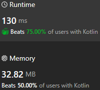

# One pass to maxDoubles

**Author:** sav20011962
**Votes:** 0
**Link:** [https://leetcode.com/problems/minimum-moves-to-reach-target-score/solutions/5224429/](https://leetcode.com/problems/minimum-moves-to-reach-target-score/solutions/5224429/)

---

# Approach
One pass to maxDoubles.
# Complexity
- Time complexity:
O(maxDoubles)
- Space complexity:
O(1)
# Code

```
class Solution {
    fun minMoves(target: Int, maxDoubles: Int): Int {
        var rez = 0
        var TARGET = target
        for (i in 0 until maxDoubles) {
            if (TARGET == 1) return rez
            if (TARGET % 2 == 1) {
                rez ++
            }
            rez ++
            TARGET /=2
        }
        return rez + TARGET - 1
    }
}
```