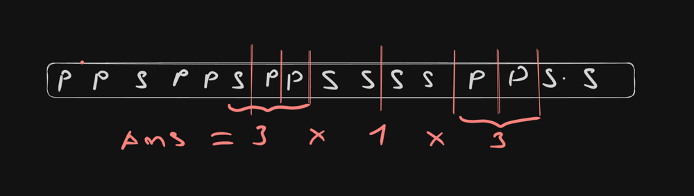

# Using combinatorial mathematics beats 100% in TS | O(n) time, O(1) space

**Author:** thinhkhang97
**Votes:** 2
**Link:** [https://leetcode.com/problems/number-of-ways-to-divide-a-long-corridor/solutions/4337390/](https://leetcode.com/problems/number-of-ways-to-divide-a-long-corridor/solutions/4337390/)

---

# Intuition
<!-- Describe your first thoughts on how to solve this problem. -->
- If number of seats is odd, the result will be 0 because there is no way to devide corridor into rooms which contains exactly 2 seats
- If there is no seats at all, the answer is 0 too
- Imagine we have only 2 seats and lots of plans around, so it's only 1 way. But if there are more 2 seats after for example **"PPPSPSPPPSS"** so number of way is 4 like this **"PPPSPS|P|P|P|SS"**.
- With this cass **"PPPSPS|P|P|P|SS|P|SS"** we have 4 ways to devide between **SPS|P|P|P|SS** and 2 ways to devide between **SS|P|SS** so the result would be 4 * 2 = 8 ways. Below are another example


# Approach
<!-- Describe your approach to solving the problem. -->
- We count the total of 'S', count the ways to device between two section of 2 seats
- Multiply the value after finish counting 
- Return 0 if the total of seats ('S') is odd or zero, return the answer
# Complexity
- Time complexity: O(n)
<!-- Add your time complexity here, e.g. $$O(n)$$ -->

- Space complexity: O(1)
<!-- Add your space complexity here, e.g. $$O(n)$$ -->

# Code
```
function numberOfWays(corridor: string): number {
    let totalS = 0, temp = 0, ans = 1, count = 0
    for (let i = 0; i < corridor.length; i++) {
        if (corridor[i] === 'S') {
            if (temp > 0) {
                ans = (ans * temp) % (10 ** 9 + 7)
                temp = 0
                count = 0
            }
            totalS++
            count++
        }
        if (count === 2) {
            temp++
        }
    }
    return totalS > 0 && totalS % 2 === 0 ? ans : 0
};
```