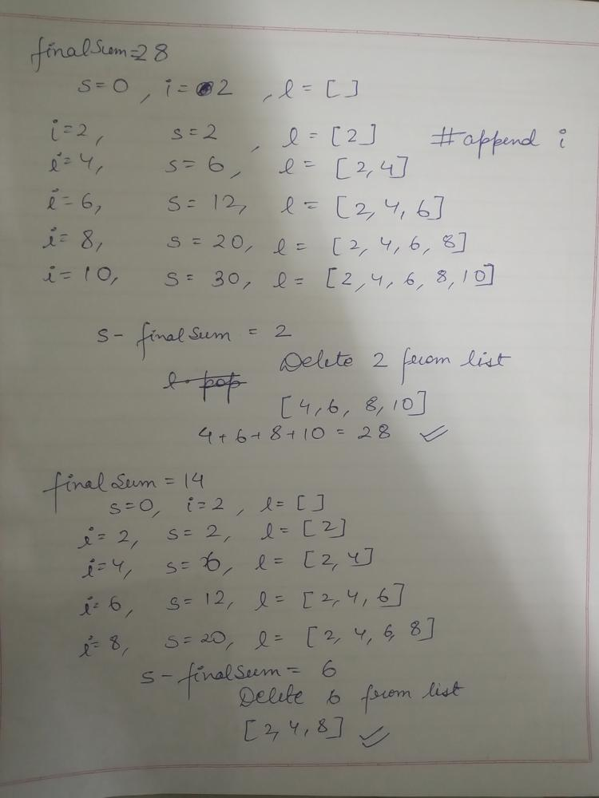
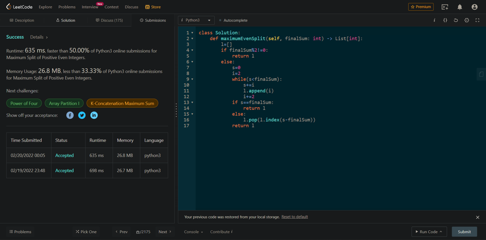

# Simple Python Solution with Explanation || O(sqrt(n)) Time Complexity || O(1) Space Complexity

**Author:** HimanshuGupta_p1
**Votes:** 58
**Link:** [https://leetcode.com/problems/maximum-split-of-positive-even-integers/solutions/1783966/](https://leetcode.com/problems/maximum-split-of-positive-even-integers/solutions/1783966/)

---

```
'''VOTE  UP, if you like and understand the solution'''
'''You are free to correct my time complexity if you feel it is incorrect.''' 
```
```
**If finalSum is odd then their is no possible way**
1. If finalSum is even then take s=0 and pointer i=2.
2.  add i in sum till s < finalSum and add i in the set l.
3.  If s == finalSum then return l
4.  else delete s from the l and return l.
```


```
class Solution:
    def maximumEvenSplit(self, finalSum: int) -> List[int]:
        l=set()
        if finalSum%2!=0:
            return l
        else:
            s=0
            i=2                       # even pointer 2, 4, 6, 8, 10, 12...........
            while(s<finalSum):
                s+=i                #sum 
                l.add(i)      # append the i in list
                i+=2
            if s==finalSum:  #if sum s is equal to finalSum then no modidfication required
                return l
            else:
                l.discard(s-finalSum)  #Deleting the element which makes s greater than finalSum
				return l
```

