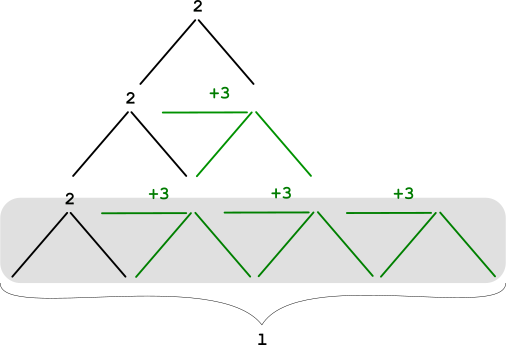

# dp ^^

**Author:** andrii_khlevniuk
**Votes:** 1
**Link:** [https://leetcode.com/problems/number-of-ways-to-build-house-of-cards/solutions/2286106/](https://leetcode.com/problems/number-of-ways-to-build-house-of-cards/solutions/2286106/)

---


**top-down/recursive**
```
class Solution 
{
    int d[502][502]{};
public:
    int houseOfCards(int n, int j=501) 
    { 
        if(d[n][j]) return d[n][j]-1;
        if(!n) return 1;
        int out{};
        for(int i{2}; i<=min(n,j-1); i+=3)
            out += houseOfCards(n-i, i);
        d[n][j]=1+out;
        return out;
    }
};
```
**bottom up dp**
```
int houseOfCards(int n) 
{         
	int d[502][502]{1};
	for(int i{1}; i<=n; ++i)
		for(int j{1}; j<=i; ++j)
			d[i][j] = d[i][j-1] + (j%3==2 ? d[i-j][min(i-j, j-1)] : 0);
	return d[n][n];
}
```