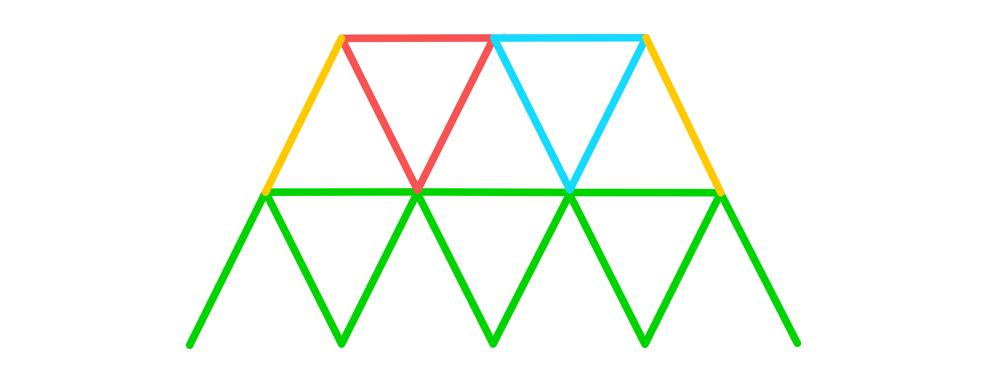
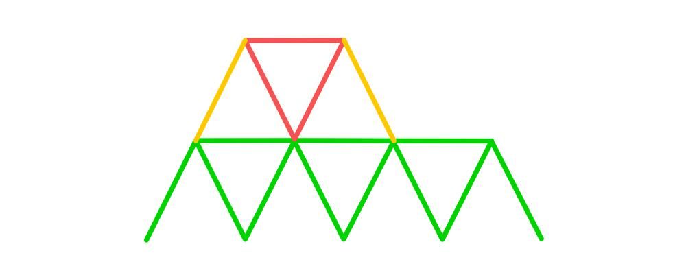

# Solution with Explanation and images

**Author:** nathannaveen
**Votes:** 1
**Link:** [https://leetcode.com/problems/number-of-ways-to-build-house-of-cards/solutions/1816490/](https://leetcode.com/problems/number-of-ways-to-build-house-of-cards/solutions/1816490/)

---

I recommend looking at the non-memoized solution instead of the solution with dp to understand the main idea because it is a lot cleaner.

In the image below, we can see three different colored triangles and two lines on the side colored yellow. This is to depict how I can place my triangles. I find the number of triangles I can make, and then I use two of my cards to make the yellow lines.


Now the colored lines are what I call the bases or in my code `b`. These are the bases of the next levels triangles.


Now we can find the maximum number of triangles that we can add on top of this row of triangles. Since we know `b = 3`, we can add a maximum of `2` triangles. This can be shown below.




We need a minimum of `8` cards for the whole second row. But let us say that we have less than `8` cards and that we have `7` cards. Because of this, we can only make one triangle. So now we can see that the number of triangles that we can make is the minimum of `(n - 2) / 3` and `b - 1` (`n - 2` is for removing the two yellow lines, and the `/ 3` is to see the number of triangles). This is shown below:




Since we know the number of triangles that we can make in a row, we can recursively make the row with `1` triangle up to the maximum number of triangles that we calculated.

We have a base case of `n == 0 || n == 2`. If `n == 0` we have no more cards and if `n == 2` we have the two extra lines, just like the image bellow:


## The Solution without Memoization - TLE:

``` go
func houseOfCards(n int) int {
    return helper(n, 500)
}

func helper(n, b int) int {
    if n == 0 || n == 2 {
        return 1
    }
    
    res := 0
    numTri := int(math.Min(float64((n - 2) / 3), float64(b - 1)))
    
    for i := 1; i <= numTri; i++ {
        res += helper(n - (i * 3) - 2, i)
    }
    
    return res
}
```

## The Solution with Memoization:

``` go
type key struct {
    a, b int
}

var dp = map[key] int{}

func houseOfCards(n int) int {
    dp = map[key] int{}
    return helper(n, 500)
}

func helper(n, b int) int {
    if n == 0 || n == 2 {
        return 1
    }
    
    if val, ok := dp[key{ n, b }]; ok {
        return val
    }
    
    res := 0
    numTri := int(math.Min(float64((n - 2) / 3), float64(b - 1)))
    
    for i := 1; i <= numTri; i++ {
        res += helper(n - (i * 3) - 2, i)
    }
    
    dp[key{ n, b }] = res
    
    return dp[key{ n, b }]
}
```