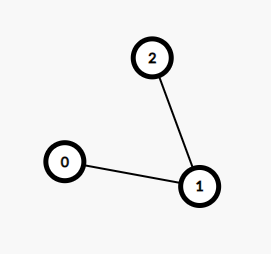

# 21 different ways to solve this problem

**Author:** TommyPang04
**Votes:** 1128
**Link:** [https://leetcode.com/problems/add-two-integers/solutions/1968134/](https://leetcode.com/problems/add-two-integers/solutions/1968134/)

---

**Many of them are good template code, feel free to copy them for later use**

Way 1: Binary Search
```
class Solution {
    public int sum(int num1, int num2) {
        int l = -200, r = 200;
        while (l < r) {
            int mid = (l + r) >> 1;
            if (mid == num1 + num2) { return mid; }
            if (mid <  num1 + num2) l = mid + 1;
            if (mid >  num1 + num2) r = mid - 1;
        }
        return l;
    }
}
        
```
Way 2: Brute Force
```
class Solution {
    public int sum(int num1, int num2) {
        for (int i = -200; i <= 200; i++) {
            if (num1 + num2 == i) {
                return i;
            }
        }
	    return -1;
    }
}
```
Way 3: Shortest path - Dijkstra

Consider distance between node 0 and 1 as num1 and distance between node 1 and 2 as num2, and the shortest path between node 0 and 2 yields the result of num1+num2.  
```
class Solution {
    List<int[]>[] adj = new List[3];
    int[] dis = new int[3];
    public int sum(int num1, int num2) {
        for (int i = 0; i < 3; i++) {
            adj[i] = new ArrayList<>();
        }
        adj[0].add(new int[] {1, num1});
        adj[1].add(new int[] {2, num2});
        return dijkstra(2, 0);
    }
    public int dijkstra(int dest, int source) {
        Arrays.fill(dis, Integer.MAX_VALUE);
        PriorityQueue<int[]> q = new PriorityQueue<>((a, b) -> {
            return a[0]-b[0];
        });
        q.add(new int[] {source, 0});
        while (!q.isEmpty()) {
            int[] cur = q.poll();
            dis[cur[0]] = cur[1];
            for (int[] nxt : adj[cur[0]]) {
                if (cur[1]+nxt[1]<dis[nxt[0]]) {
                    q.add(new int[] {nxt[0], cur[1]+nxt[1]});
                }
            }
        }
        return dis[dest];
    }
}
```
Way 4: Shortest path - Floyd
Idea is same as above
```
class Solution {
    int[][] dis = new int[3][3];
    public int sum(int num1, int num2) {
        for (int i = 0; i <= 2; i++) {
            Arrays.fill(dis[i], 10000);
        }
        dis[0][1] = num1;
        dis[1][2] = num2;
        return floyd(2, 0);
    }
    public int floyd(int dest, int source) {
        for (int k = 0; k <= 2; k++) {
            for (int i = 0; i <= 2; i++) {
                for (int j = 0; j <= 2; j++) {
                    dis[i][j] = Math.min(dis[i][j], dis[i][k] + dis[k][j]);
                }
            }
        }
        return dis[source][dest];
    }
}
```
Way 5: Prefix Sum
```
class Solution {
    public int sum(int num1, int num2) {
        int[] A = new int[] {num1, num2};
        int[] prefixSum = new int[A.length+1];
        for (int i = 0; i < A.length; i++) {
            prefixSum[i+1] = prefixSum[i] + A[i];
        }
        return prefixSum[A.length];
    }
}
```
Way 6: Suffix Sum
```
class Solution {
    public int sum(int num1, int num2) {
        int[] A = new int[] {num1, num2};
        int[] suffixSum = new int[A.length+2];
        for (int i = A.length; i >= 1; i--) {
            suffixSum[i] = suffixSum[i+1] + A[i-1];
        }
        return suffixSum[1];
    }
}
```
Way 7: Segment Tree Range Sum Query
```
class Solution {
    int n = 2;
    int[] segTree = new int[n*4];
    int[] A;
    public int sum(int num1, int num2) {
        A = new int[] {num1, num2};
        build(1, n, 1);
        return querySum(1, n, 1, n, 1);
    }
    public int querySum(int l, int r, int ql, int qr, int idx) {
        if (l == ql && r == qr) return segTree[idx];
        int m = (l+r)/2;
        if (ql > m) return querySum(m+1, r,ql,qr,2*idx+1 );
        else if (qr<=m) return querySum(l, m, ql, qr,2*idx);
        else return querySum(l,m,ql, m, 2*idx) + querySum(m+1, r, m+1,qr, 2*idx+1);
    }
    public void build(int l, int r, int idx)  {
        if (l == r) {
            segTree[idx] = A[l-1];
            return;
        }
        int m = (l+r)/2;
        build(l , m, idx*2); build(m+1, r, idx*2+1);
        segTree[idx] = segTree[2*idx] + segTree[2*idx+1];
    }
}
```
Way 8: Binary Indexed Tree (Fenwick Tree) Range Sum Query
```
class Solution {
    int n = 2;
    int[] bit = new int[n+1];  

    public int sum(int num1, int num2) {
        add(1, num1); add(2, num2);
        return querySum(1, n);
    }

    public int bitSum(int r) {
        int ret = 0;
        for (; r > 0; r-=(r&-r))
            ret += bit[r];
        return ret;
    }

    public int querySum(int l, int r) {
        return bitSum(r) - bitSum(l - 1);
    }

    public void add(int idx, int delta) {
        for (; idx < bit.length; idx+=(idx&-idx)) {
            bit[idx] += delta;
        }
    }
}
```
Way 9: Bit Manipulation
```
class Solution {
    public int sum(int num1, int num2) {
        if (num2 == 0) return num1;
        return sum(num1 ^ num2, (num1 & num2) << 1);
    }
}
```

Way 10: Brute Force v2 (Suggested by zayne-siew)
```
class Solution {
    public int sum(int num1, int num2) {
        int res = 0;
        while (num1 != 0) {
            res += inc(num1);
            num1 -= inc(num1);
        }
        while (num2 != 0) {
            res += inc(num2);
            num2 -= inc(num2);
        }
        return res;
    }
    
    private int inc(int num) {
        return num > 0 ? 1 : -1;
    }
}
```
Way 11: Minimum Spanning Tree - Kruskal
```
class Solution {
    int n = 3;
    List<edge> edges = new ArrayList<>();
    int [] rank = new int[n], leader = new int[n];
    public int sum(int num1, int num2) {
        for (int i = 0; i < n; i++) {
            leader[i] = i;
        }
        edges.add(new edge(0, 1, num1));
        edges.add(new edge(1, 2, num2));
        Collections.sort(edges);
        int ans = 0;
        for (edge nxt : edges) {
            if (find(nxt.u) != find(nxt.v)) {
                union(nxt.v, nxt.u);
                ans += nxt.w;
            }
        }
        return ans;
    }
    public void union(int a, int b){
        a = find(a); b = find(b);
        if(a != b) {
            if (rank[a] > rank[b]) {
                rank[a]++;
                leader[b] = a;
            } else {
                rank[b]++;
                leader[a] = b;
            }
        }
    }

    public int find(int n){
        if (n != leader[n]){
            leader[n] = find(leader[n]);
        }
        return leader[n];
    }
    public class edge implements Comparable<edge> {
        int u, v, w;
        edge(int i, int j, int c) {
            u = i; v = j; w = c;
        }

        @Override
        public int compareTo(edge o) {
            return w-o.w;
        }
    }
}
```
Way 12: Directly Add (Lmaoooooo)
```
class Solution {
    public int sum(int num1, int num2) {
        return num1+num2;
    }
}
```
Way 13: Divide And Conquer 
```
class Solution {
    int n = 3;
    int[] A = new int[n];
    public int sum(int num1, int num2) {
        A[1] = num1; A[2] = num2;
        return fun(1, 2);
    }
    public int fun(int l, int r) { 
        if (l==r) return A[l];
        int m = (l+r)>>1;
        return fun(l, m) + fun(m+1, r);
    }
}
```
Way 14: Bellman\u2013Ford Algorithm
```
class Solution {
    int n = 3, m = 2;
    List<e> edge = new ArrayList<>();
    public int sum(int num1, int num2) {
        edge.add(new e(0, 1, num1));
        edge.add(new e(1, 2, num2));
        return BellmanFord(0, 2);
    }
    public int BellmanFord(int src, int dest) {
        int[] dis = new int[n];
        Arrays.fill(dis, Integer.MAX_VALUE);
        dis[src] = 0;
        for (int i = 1; i < n; ++i) {
            for (int j = 0; j < m; ++j) {
                int u = edge.get(j).a;
                int v = edge.get(j).b;
                int w = edge.get(j).c;
                if (dis[u] != Integer.MAX_VALUE && dis[u] + w < dis[v])
                    dis[v] = dis[u] + w;
            }
        }
        return dis[dest];
    }
    public class e {
        int a, b, c;
        e(int f, int s, int w) {
            a = f; b = s; c = w;
        }
    }
}
```
Way 15: Quick Power(Exponentiation by squaring)
```
class Solution {
    int M = (int) 1e9+7;
    public int sum(int num1, int num2) {
        return pow(num1, 1) + pow(num2, 1);
    }
    public int pow (int x, int exp){
        if (exp==0) return 1;
        int t = pow(x, exp/2);
        t = t*t % M;
        if (exp%2 == 0) return t;
        return t*x % M;
    }
}
```
Way 16: Difference Array Range Add Operation
```
class Solution {
    public int sum(int num1, int num2) {
        int[] dif = new int[4];
        List<range> add = new ArrayList<>(Arrays.asList(new range(1, 2, num1), new range(1, 2, num2)));
        for (range op : add) {
            dif[op.l] += op.v;
            dif[op.r+1] -= op.v;
        }
        for (int i = 1; i < 4; i++) {
            dif[i] += dif[i-1];
        }
        return dif[2];
    }
    public class range {
        int l, r, v;
        range(int lft, int rht, int val) {
            l = lft; r = rht; v = val;
        }
    }
}
```
Way 17: Sparse Table RMQ
Consider the int array A: {-1, 2, 10}, where num1 is 2 and num2 is 10. The value -1 is not part of the operation. Here range_min(left_bound_index = 1, right_bound_index = 2) = 2, and range_max(left_bound_index = 1, right_bound_index = 2) = 10, lastly the sum is 2+10 gives us the result of num1+num2 which is 12.  
```
class Solution {
    int n = 2;
    public int sum(int num1, int num2) {
        int[] A = new int[] {-1, num1, num2};
        int [][] maxTable = new int[n+1][(int) (Math.log(n)/Math.log(2))+1];
        int [][] minTable = new int[n+1][(int) (Math.log(n)/Math.log(2))+1];
        for (int i = 1; i <= n; i++) {
            maxTable[i][0] = A[i];
            minTable[i][0] = A[i];
        }
        for (int i = 1; 1<<i <= n; i++) {
            for (int j = 1; j+(1<<i)-1 <= n; j++) {
                maxTable[j][i] = Math.max(maxTable[j][i-1], maxTable[j+(1<<(i-1))][i-1]);
                minTable[j][i] = Math.min(minTable[j][i-1], minTable[j+(1<<(i-1))][i-1]);
            }
        }
        return minQuery(1, n, minTable) + maxQuery(1, n, maxTable); // interval max + interval min = nums1 + nums2
    }
    public int maxQuery(int l, int r, int [][] table) {
        int j = (int) (Math.log(r-l+1)/Math.log(2));
        return Math.max(table[l][j], table[r-(1<<j)+1][j]);
    }
    public int minQuery(int l, int r, int [][] table) {
        int j = (int) (Math.log(r-l+1)/Math.log(2));
        return Math.min(table[l][j], table[r-(1<<j)+1][j]);
    }
}
```
Way 18: The Method Of Classification Discussion (suggested by greg66611)
```
class Solution {
    public synchronized strictfp Integer sum(final int... a) { 
        if (a[0]>a[1]){
            return -(a[1]-a[0]-a[1]-a[1]);
        }
        if (a[0]<a[1]){
            return -(a[0]-a[1]-a[0]-a[0]);
        }
        if (a[0]<0) {
            return -2*(a[0]-a[0]-a[0]);
        }
        return sum(a[0]-1,a[1]+1);
    }
}
```
Way 19: Evaluation Of String Expression
This solution incorporates divide and conquer ideas of broken expression down into smaller parts to evaluate. Also note that this util function can also solve LeetCode [224. Basic Calculator](https://leetcode.com/problems/basic-calculator/)
```
class Solution {
    public int sum(int num1, int num2) {
        int sign1 = num1 < 0 ? -1 : 1;
        int sign2 = num2 < 0 ? -1 : 1;
        if (sign1 * sign2 == -1) {
            if (num1>num2) {
                String expression = num1 + "-" + num2;
                return eval((expression).toCharArray(), 0,expression.length()-1);
            }
            else {
                String expression = num2 + "-" + Math.abs(num1);
                return eval((expression).toCharArray(), 0,expression.length()-1);
            }
        }   
        else {
            if (sign1<0) {
                String expression = "-(" + Math.abs(num1) + "+" + Math.abs(num2) + ")";
                return eval((expression).toCharArray(), 0,expression.length()-1);
            }
            else {
                String expression = num1 + "+" + num2;
                return eval((expression).toCharArray(), 0,expression.length()-1);
            }
        }
    }
    public int eval(char[] s, int l, int r) {
        Stack<Integer> nums = new Stack();
        int cur = 0;
        char sign = '+';
        for (int i = l; i <= r; i++) {
            if (Character.isDigit(s[i])) {
                cur = cur * 10 + s[i] - '0';
            }
            if (!Character.isDigit(s[i]) || i==r) {
                if (s[i] == '(') {
                    int left = 1, right = 0;
                    for (int j = i+1; j <= r; j++) {
                        if (s[j]=='(') left++;
                        else if (s[j]==')') right++;
                        if (left==right) {
                            cur = eval(s, i+1, j-1);
                            i = j;
                            break;
                        }
                    }
                }
                switch (sign) {
                    case '+':
                        nums.push(cur);
                        break;
                    case '-':
                        nums.push(-cur);
                        break;
                    case '*':
                        nums.push(cur * nums.pop());
                        break;
                    case '/':
                        nums.push(nums.pop() / cur);
                        break;
                }
                sign = s[i];
                cur = 0;
            }
        }
        int res = 0;
        while (!nums.isEmpty()) res+=nums.pop();
        return res;
    }
}
```
Way 20: Merge Sort
```
class Solution {
    int ans = 0;
    public int sum(int num1, int num2) {
        int[] A = new int[] {num1, num2};
        mergeSort(A, 0, 1);
        return ans;
    }
    public void mergeSort(int[] nums, int l, int r) {
        if (l>=r) return;
        int mid = l+r>>1;
        mergeSort(nums, l, mid); mergeSort(nums, mid+1, r);
        int i = l, j = mid+1, k = 0;
        int[] cur_sorted = new int[r-l+1];
        while (i<=mid && j<=r) {
            if (nums[i] <= nums[j]) {
                cur_sorted[k++] = nums[i++];
            }
            else cur_sorted[k++] = nums[j++];
        }
        while (i<=mid) cur_sorted[k++] = nums[i++];
        while (j<=r) cur_sorted[k++] = nums[j++];
        for (int m = 0; m < r-l+1; m++) {
            nums[m+l] = cur_sorted[m];
            ans+=cur_sorted[m]; // works since there's only two numbers
        }
    }
}
```
Way 21: Bucket Sort
```
class Solution {
    public int sum(int num1, int num2) {
        int[] A = new int[] {num1, num2};
        return bucketSort(A);
    }
    public int bucketSort(int[] nums) {
        int min = 1<<30, max = -(1<<30), n = nums.length;
        for (int v : nums) {
            min = Math.min(v, min);
            max = Math.max(v, max);
        }
        int range = max-min;
        int size = range/n+1;
        int bucketNum = n;
        List<Integer>[] buckets = new List[bucketNum];
        for (int i = 0; i < bucketNum; i++) {
            buckets[i] = new ArrayList<>();
        }
        for (int v : nums) {
            int idx = (v-min)/size;
            buckets[idx].add(v);
        }
        int ans = 0;
        for (List<Integer> sorted : buckets) {
            Collections.sort(sorted);
            for (int v : sorted) {
                ans+=v;
            }
        }
        return ans;
    }
}
```


