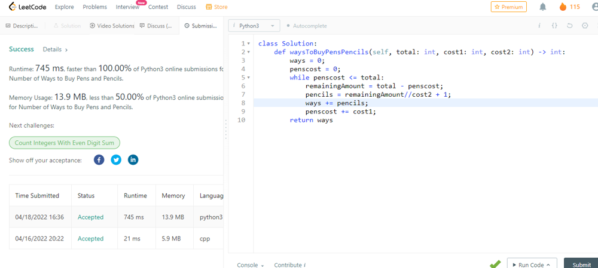

# C++ | Python | Java | Greedy | O(n) | 100% faster

**Author:** TejPratap1
**Votes:** 20
**Link:** [https://leetcode.com/problems/number-of-ways-to-buy-pens-and-pencils/solutions/1953663/](https://leetcode.com/problems/number-of-ways-to-buy-pens-and-pencils/solutions/1953663/)

---

**This is a question of observing**
First example clearly gives idea to solve this.
Input: total = 20, cost1 = 10, cost2 = 5
Output: 9
Explanation: The price of a pen is 10 and the price of a pencil is 5.
- If you buy 0 pens, you can buy 0, 1, 2, 3, or 4 pencils.
- If you buy 1 pen, you can buy 0, 1, or 2 pencils.
- If you buy 2 pens, you cannot buy any pencils.
The total number of ways to buy pens and pencils is 5 + 3 + 1 = 9.

**Idea: Buy pen and count possible ways to buy pencils**
* As we can see we have to try number of ways:
* just calulate how much pen i can buy with this total
* for example in 1st expmple you can buy from range 0 to 2 pens.
* So available choice are 0 pens, for that just think how much pencil you can buy 
* i.e m = remaining amount / pencil cost
* you can buy maximum m pencils so you have m + 1 choices
* Now try for next choosen way of pen buying i.e buy 1 pen. 

**C++**
```
class Solution {
public:
    long long waysToBuyPensPencils(int total, int cost1, int cost2) {
        long long ways = 0;
        long long penscost = 0;
        while(penscost <= total) {
            long long remainingAmount = total - penscost;
            long long pencils = remainingAmount/cost2 + 1;
            ways += pencils;
            penscost += cost1;
        }
        return ways;
    }
};
```

**Python**
```
class Solution:
    def waysToBuyPensPencils(self, total: int, cost1: int, cost2: int) -> int:
        ways = 0;
        penscost = 0;
        while penscost <= total:
            remainingAmount = total - penscost;
            pencils = remainingAmount//cost2 + 1;
            ways += pencils;
            penscost += cost1;
        return ways
```

**Java**
```
class Solution {
    public long waysToBuyPensPencils(int total, int cost1, int cost2) {
        long ways = 0;
        long penscost = 0;
        while(penscost <= total) {
            long remainingAmount = total - penscost;
            long pencils = remainingAmount/cost2 + 1;
            ways += pencils;
            penscost += cost1;
        }
        return ways;
    }
}
```




**If you have any doubt comment, upvote if liked.**