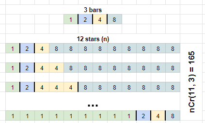
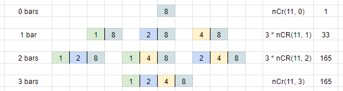

# Sieve of Eratosthenes - O(maxValue)

**Author:** votrubac
**Votes:** 34
**Link:** [https://leetcode.com/problems/count-the-number-of-ideal-arrays/solutions/2265366/](https://leetcode.com/problems/count-the-number-of-ideal-arrays/solutions/2265366/)

---

I was proud of my optimized tabulation solution. It works for `n` up to `7000`, but gives TLE for higher `n`. So close, but I could not optimize it any further.
 
Only then I realized that it needs a combinatorial solution instead.
 
#### Sieve of Eratosthenes - Stars and Bars (3 ms)
How many unique numbers can we have in an ideal array? Not many. If max value is limited to 10,000, then we will have no more than 14 unique numbers.  
 
Now, how many unique ideal arrays can we produce with those unique numbers and `n` slots? Note that, in an ideal array, those numbers must appear in the non-decreasing order.
This is the "Stars and Bars" problem, and the number of different ways to generate ideal arrays is `nCr[stars - 1][bars]`, where `starts == n`, and `bars` is the number of unique numbers.



In essence, for any number, we only need to figure **lenghes** (bars) of each unique numbers combination, and count those lenghes.
 
**C++**
The first part is really a one-time computation (note that we preserve result in the global variables): 
	- compute `comb` (nCr) using the Pascal triangle technique. 
	- use the "Sieve of Eratosthenes" approach to accumulate the count of each unique numbers arrangement.
		- if a number `i` is divisible by `div`, it "inherits" all bars of `div`, adding `1` to each bar.
 
After one-time computation, we can get the result in O(maxValue).



```cpp
int comb[10001][14] = { 1 }, cnt[10001][14] = {}, mod = 1000000007;
class Solution {
public: 
int idealArrays(int n, int maxValue) {
    if (comb[1][1] == 0) { // one-time computation.
        for (int s = 1; s <= 10000; ++s) // nCr (comb)
            for (int r = 0; r < 14; ++r)
                comb[s][r] = r == 0 ? 1 : (comb[s - 1][r - 1] + comb[s - 1][r]) % mod;
        for (int div = 1; div <= 10000; ++div) { // Sieve of Eratosthenes
            ++cnt[div][0];
            for (int i = 2 * div; i <= 10000; i += div)
                for (int bars = 0; cnt[div][bars]; ++bars)
                    cnt[i][bars + 1] += cnt[div][bars];
        }
    }
    int res = 0;
    for (int i = 1; i <= maxValue; ++i)
        for (int bars = 0; bars < min(14, n) && cnt[i][bars]; ++bars)
            res = (1LL * cnt[i][bars] * comb[n - 1][bars] + res) % mod;
    return res;
}
};
```

#### Sieve of Eratosthenes - Tabulation (TLE)
We use 1D tabulation array, and for each iteration we fill it from smaller value to larger.

We go from smallest to largest, and a value `j` we add number of arrays from previous iteration from `j * 2`, `j * 3`, `j * 4`, and so on ("Sieve of Eratosthenes").

We only go to `maxValue / 2`, because the number of arrays is `1` for all values above.

**C++**
```cpp
int dp[10000] = {}, mod = 1000000007;
class Solution {
public:
    int idealArrays(int n, int maxValue) {
        fill(begin(dp), begin(dp) + maxValue, 1);
        for (int i = 1; i < n; ++i)
            for (int j = 1; j <= maxValue / 2; ++j) {
                for (int k = 2 * j; k <= maxValue / 2; k += j)
                    dp[j - 1] = (dp[j - 1] + dp[k - 1]) % mod;
                dp[j - 1] = (dp[j - 1] + maxValue / j - maxValue / 2 / j) % mod;
            }
        return accumulate(begin(dp), begin(dp) + maxValue, 0, [&](int s, int n){ return (s + n) % mod; });
    }
};
```