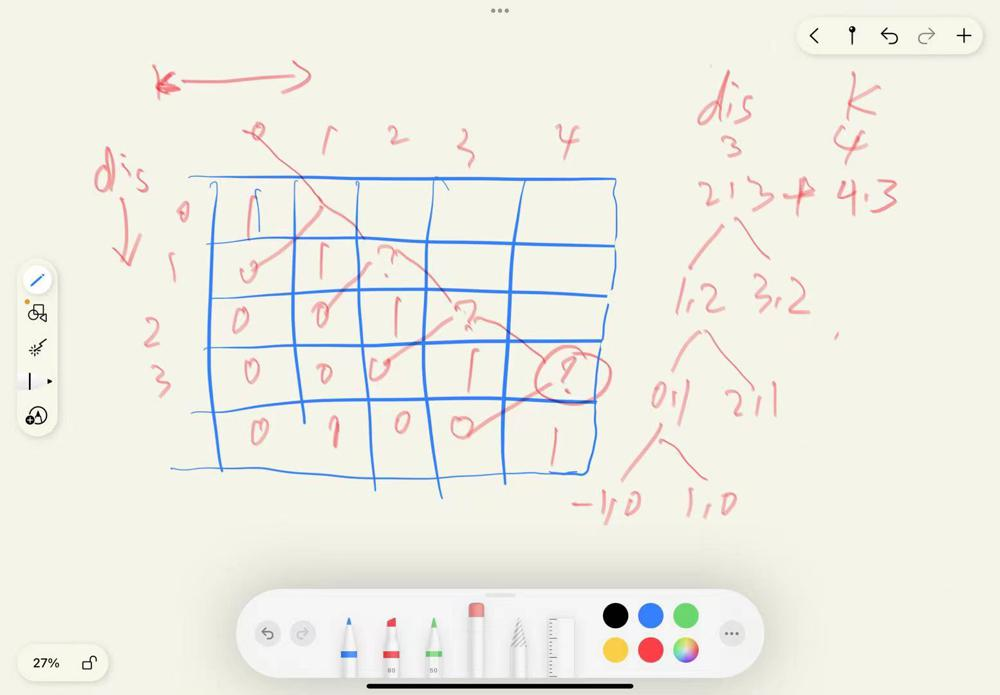

# js dp with some comments

**Author:** Junting-Liu
**Votes:** 3
**Link:** [https://leetcode.com/problems/number-of-ways-to-reach-a-position-after-exactly-k-steps/solutions/2529435/](https://leetcode.com/problems/number-of-ways-to-reach-a-position-after-exactly-k-steps/solutions/2529435/)

---

regard on this [solution](https://leetcode.com/problems/number-of-ways-to-reach-a-position-after-exactly-k-steps/discuss/2527267/Top-Down-DP)



```
/**
 * @param {number} startPos
 * @param {number} endPos
 * @param {number} k
 * @return {number}
 */

// dis is always positive, so we calculate dis and k

var mod = 1e9 + 7;
// dis index 0-999  k index 0-1000, according to conditions
const dp = new Array(1000).fill(0).map((_)=>new Array(1001).fill(0));

var numberOfWays = function(startPos, endPos, k) {
    var dfs = (dis, k) => {
        if (dis > k) { return 0}
        if (dis === k) { return 1}

        // 0 means hasn't visited
        if (dp[dis][k] == 0) {
            // [dis, k] = [dis+1, k-1] + [dis-1, k-1] , but dis - 1 may be a negative value - 1, -1 is same 1
            dp[dis][k] = (1 + dfs(dis + 1, k - 1) + dfs(Math.abs(dis - 1), k - 1)) % mod;
        }
            
        // to distiguish visited and unvisited, we change default to 1, then before return should  -1
        return dp[dis][k] - 1;
    } 
    return dfs(Math.abs(startPos - endPos), k);
}

```