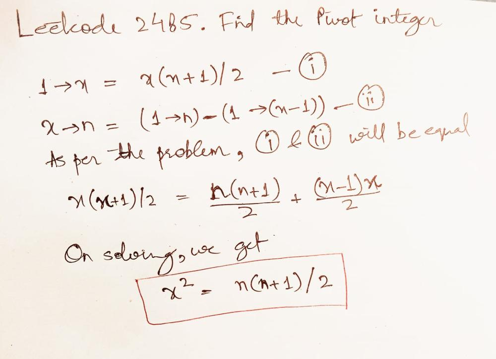

# 📐Maths is everywhere & you can't escape it | AP | Maths | Explained

**Author:** olifarhaan
**Votes:** 141
**Link:** [https://leetcode.com/problems/find-the-pivot-integer/solutions/4866663/](https://leetcode.com/problems/find-the-pivot-integer/solutions/4866663/)

---

<!-- Describe your first thoughts on how to solve this problem. -->

# Approach
`1 \u2192 n` means sum from one to n.



1. Calculate the sum of integers.
- 1 to x = `x(x+1)/2`
- x to n = `(1 to n) - (1 to (x-1))` 
- Equating both we get, `x^2= n(n+1)/2` 

2. Find the square root of the `sum=n(n+1)/2`:

- Take the square root of the sum calculated in step 1 and store it in variable a.
- Check if the square root is an integer:
    - If the square root is an integer, it implies that the `pivot` point exists and that the sum of integers from `1` to that `pivot` point is equal to the sum of integers from the `pivot` point to 
`n`
n.
    - We can check if the difference between the square root and its ceiling value (rounded up) is zero. If it is, it means the square root is an integer.
    - If the difference is zero, return the square root as the pivot integer.
    - If not, return -1, indicating that there's no valid pivot integer.

3. Return the result:

- If the square root is an integer, return it as the pivot integer.
- If not, return -1.

# Complexity
- Time complexity: `O(1)`
<!-- Add your time complexity here, e.g. $$O(n)$$ -->

- Space complexity: `O(1)`
<!-- Add your space complexity here, e.g. $$O(n)$$ -->

# Upvote the solution:


**Do checkout the video explanation if you are unable to understand**

https://www.youtube.com/watch?v=K1DDGMVbmsk


# Code

```java []
class Solution {
    public int pivotInteger(int n) {
        int sum= n*(n+1)/2;
        double a= Math.sqrt(sum);

        if( a- Math.ceil(a)==0) return (int)a;
        else return -1;
    }
}
```
```python []
class Solution:
    def pivotInteger(self, n: int) -> int:
        sum = n * (n + 1) // 2
        a = math.sqrt(sum)

        if a - math.ceil(a) == 0:
            return int(a)
        else:
            return -1
        
```
```C++ []
class Solution {
public:
    int pivotInteger(int n) {
        int sum = n * (n + 1) / 2;
        double a = sqrt(sum);

        if (a - ceil(a) == 0)
            return int(a);
        else
            return -1;
    }
};
```
