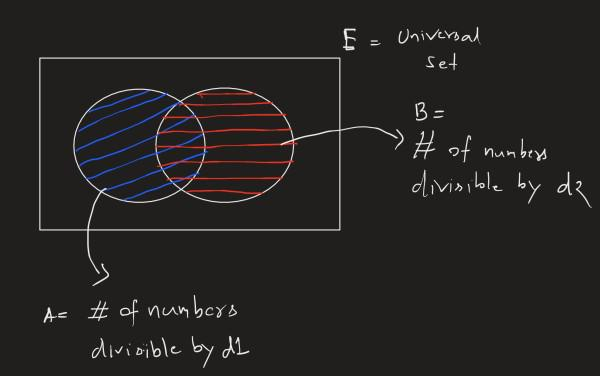

# Binary Search + Venn Diagram (Set Diagrams) | Explanation with diagram

**Author:** jigyansunanda
**Votes:** 62
**Link:** [https://leetcode.com/problems/minimize-the-maximum-of-two-arrays/solutions/2946511/](https://leetcode.com/problems/minimize-the-maximum-of-two-arrays/solutions/2946511/)

---

**Idea:**
* Binary Search on possible answer. For each possible candidate `(say x)` I will check that whether if I take values from `[1, x]` will I be able to satisfy or not ? If `yes` then all numbers `>= x` will always be valid answers. so I go towards lesser numbers. Similarly if `x` does not satisfy the requirement then no number `<= x` will be able to. So in that case we move higher.
* How to check whether a number `x` satisfies the requirements or not ? Check the diagram below. It's just mathematics. Explained in code comments of `check()` function




```cpp
class Solution {
public:
    int minimizeSet(int d1, int d2, int u1, int u2) {
        long long lo = 1, hi = 1e17;
        while (hi > lo + 1) {
            long long mid = (lo + hi) >> 1;
            if (check(d1, d2, u1, u2, mid)) hi = mid;
            else lo = mid;
        }
        return hi;
    }

    bool check(long long d1, long long d2, long long u1, long long u2, long long x) {
        long long A = x / d1;  // A = # of numbers divisible by d1
        long long A_ = x - A;  // A' = # of numbers not divisible by d1
        long long B = x / d2;	// B = # of numbers divisible by d2
        long long B_ = x - B;	// B' = # of numbers not divisible by d2
        long long AIB = x / lcm(d1, d2); // A Intersection B = # of numbers divisible by BOTH d1 AND d2
        long long AuB = A + B - AIB;	// A Union B = # of numbers divisible by EITHER d1 OR d2
        long long A_I_B_ = x - (AuB);	// (A' Union B') = (A Intersection B)' = # of numbers not divisible by NEITHER OF THEM

        // needA = # of numbers needed to have atleast u1 numbers of set1, these numbers
        // don't include (A' Union B')
        long long needA = (A_ - A_I_B_ >= u1) ? 0 : u1 - (A_ - A_I_B_);

        // needB = # of numbers needed to have atleast u2 numbers of set2, these numbers
        // don't include (A' Union B')
        long long needB = (B_ - A_I_B_ >= u2) ? 0 : u2 - (B_ - A_I_B_);

        /*
        Why not consider (A' Union B') ?
        -> I will assign those numbers to whichever set needs it.
        */

        // Available (A' Union B') value should be more than the needed # of values to make sets
        return (A_I_B_ >= needA + needB);
    }
};
```