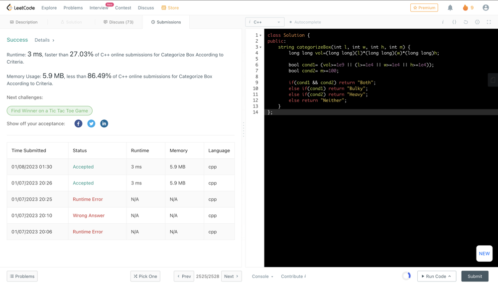

# ✅C++ || Simple Implementation || CLEAN  && EASY CODE

**Author:** abhinav_0107
**Votes:** 6
**Link:** [https://leetcode.com/problems/categorize-box-according-to-criteria/solutions/3015715/](https://leetcode.com/problems/categorize-box-according-to-criteria/solutions/3015715/)

---

**T->O(1) && S->O(1)**

	class Solution {
		public:
			string categorizeBox(int l, int w, int h, int m) {
				long long vol=(long long)(l)*(long long)(w)*(long long)h;

				bool cond1= (vol>=1e9 || (l>=1e4 || w>=1e4 || h>=1e4));
				bool cond2= m>=100;

				if(cond1 && cond2) return "Both";
				else if(cond1) return "Bulky";
				else if(cond2) return "Heavy";
				else return "Neither";
			}
		};